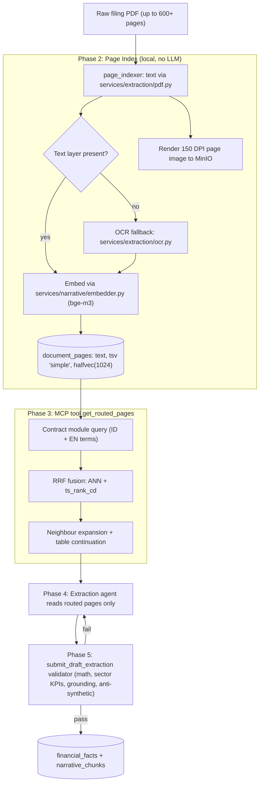

# EmiMind — Deep Extraction Remediation Plan (v3: Vector-Routed, MCP-Native)

> **Architectural & Execution Blueprint:** Moving from shallow headline extraction to institutional-grade financial depth using **hybrid page routing (BM25 + vector, RRF)** exposed as an MCP tool, with **targeted page-level extraction** by the MCP extraction agent and grounding enforced by the validator.

---

## 1. Problem Statement & Root Cause Analysis

An audit of the PostgreSQL database (`emimind`) found that despite 5,857 processed documents and 174,253 financial facts:
* **The data is functionally shallow:** 99% of facts are restricted to ~30 generic top-level balance sheet and income statement aggregates (`ifrs:Assets`, `ifrs:Revenue`, `ifrs:ProfitLoss`).
* **Granular disclosure notes are virtually absent:** Across 230 tickers, 228 have **zero** customer concentration disclosures, bank placement breakdowns, or debt facilities.
* **Sector operational KPIs are missing:** Banking ratios (`NIM`, `NPL`, `LDR`, `CASA`) and plantation metrics (`FFB yield`, `Mature hectares`) exist for only 1–2 test tickers.
* **Synthetic filler polluted the database:** In tickers like `AALI`, note segments were fabricated by heuristic splits (e.g. 70% "Primary Operations" / 30% "Other Operations").
* **Narratives are 97.5% boilerplate copy-paste:** Of 29,401 narrative chunks, 28,679 are the exact same generic sentence.
* **Document metadata is corrupted:**
  * `services/mcp/server.py:345` registers every document with hardcoded `period_end = '2024-12-31'` and `page_count = 1`.
  * `services/mcp/server.py:294` defaults `fiscal_period` to `"2024Q4"` whenever the filename has no `Q`, so historical filings such as `2020-TW1` are collapsed into `2024Q4`.
* **The commit path corrupts granular facts** (`commit_verified_report`):
  * It **invents segments** from row labels when the agent sent none (keyword heuristics such as `"pupuk" → cogs_component`) — a direct source of synthetic segment data.
  * The upsert key is `(ticker, fiscal_period, concept_id, segment->>'segment')`, so multi-dimensional segments (e.g. collectibility × loan segment) **collide and silently overwrite** each other.
  * Statement type is guessed by substring: any concept containing `Cash` is classified `BS`/`instant`, so `CashFlows…` concepts are mislabelled.
  * `extraction_conf` is hardcoded to `0.95`, `source_bbox` is never stored, and the year falls back to `2024` when unparseable.

> **Execution tasks:** the step-by-step build list with targets and self-verifiable done criteria is [`tasks/09-M9-deep-extraction.md`](../tasks/09-M9-deep-extraction.md).

### The Dual Failure Mode: Why Single Prompts & Pure Regex Both Fail
1. **The LLM cannot read the entire 600-page book:** Reports like Bank Mandiri are **603 pages**. Whole-book context causes attention degradation (*lost-in-the-middle*), output truncation, and prohibitive token cost.
2. **Deterministic regex parsers are too fragile:** Regex table slicing breaks on scanned PDFs, non-standard note naming, borderless tables, multi-column restatements, and dozens of auditor layout styles.

---

## 2. Target Architecture

The core idea: **hybrid search locates the exact pages; the MCP extraction agent reads only those pages; the validator proves every number is grounded on the cited page.**

Who does what:
* **MCP server** (`services/mcp/server.py`) — owns ingestion state, page index, routing, contracts, and validation. It does **not** call an LLM itself.
* **Extraction agent** (the MCP client) — calls the tools, reads routed pages (text + image), and submits drafts. Model choice is a client concern and is not hard-coded in this plan.



---

## 3. Remediation Execution Plan (6 Phases)

### Phase 1: Database Reset & Server Metadata Fixes

#### 1.1 Reset Runtime Extraction Data
* Use the standard reset: `python scripts/reset_extraction_data.py --yes`.
  * It purges runtime extraction tables (`financial_facts`, `narrative_chunks`, `derived_metrics`, `kg_nodes`, `kg_edges`, `documents`, `document_processing_log`, `ingest_review_queue`, …).
  * It preserves config/ontology (`issuer_profile`, `metric_definitions`, `concept_map`, `sector_metric_contracts`, `peer_groups`, announcement contracts).
* **Do not use `scripts/clean_documents.py`** for this: it also truncates user-facing tables (`conversation_turns`, `citation_reports`). Mark it deprecated or delete it so there is exactly one reset path.
* The reset happens **after** the 1.2 fixes land, so re-ingestion never reintroduces bad metadata.

#### 1.2 Fix Period & Metadata Resolution in `services/mcp/server.py`
Extract period parsing into a pure, unit-tested function (e.g. `services/mcp/periods.py::resolve_fiscal_period(filename, hint) -> (fiscal_period, period_end)`), used by `inspect_document`.

* **Keep the existing period convention: `YYYYQ1..YYYYQ4`, where the full-year/audited filing is `YYYYQ4`.** The codebase, tests, and contracts use `YYYYQ4` for year-end (~143 references vs. a handful of `YYYYFY`); no format migration is introduced. Any stray `YYYYFY` literals in code/tests are normalized to `YYYYQ4` in the same change.
* Mapping (case-insensitive, tolerant of spaces, `-`, `_`):

  | Filename token(s) | Resolved | `period_end` |
  |---|---|---|
  | `TW1`, `TW 1`, `-I-`, `Q1`, `3M`, `Maret`/`Mar` | `YYYYQ1` | `YYYY-03-31` |
  | `TW2`, `TW 2`, `-II-`, `Q2`, `6M`, `H1`, `1H`, `Semester 1`, `Juni`/`Jun` | `YYYYQ2` | `YYYY-06-30` |
  | `TW3`, `TW 3`, `-III-`, `Q3`, `9M`, `September`/`Sep` | `YYYYQ3` | `YYYY-09-30` |
  | `Q4`, `AUDIT`, `Tahunan`, `FY`, `12M`, `AAR`, `AR`, `Annual`, `Des`/`Dec` | `YYYYQ4` | `YYYY-12-31` |

* **Year resolution:** a 4-digit year in the filename (`2020`), or a 2-digit year in forms like `1H26`/`FY25` (→ `20YY`). Where the filename yields no year or period, the document is **not** silently defaulted: it falls back to `services/extraction/metadata_extractor.py` (cover-page parsing); if that also fails, `inspect_document` returns a status requiring the agent to supply `fiscal_period` explicitly. The `"2024Q4"` default is removed.
* Explicit `fiscal_period` passed by the agent always wins, but is validated against the same grammar.
* **Document registration:** remove the hardcoded `'2024-12-31'` and `1`; insert the computed `period_end` and the real `page_count` from `pymupdf.open(path).page_count`.
* **Tests:** table-driven unit tests covering every row above, including real filenames from `incoming_reports/` history (`202603_ULTJ_Group_Q1_FR.pdf`, `LSIP_bilingual_30_Jun_2026_Released.pdf`, `Financial Statements 1H26.pdf`, `Laporan Keuangan TBP 30 Juni 2026.pdf`).

#### 1.3 Fix the Commit Path in `commit_verified_report`
* **Never invent segments.** Delete the label-keyword segment inference. The server stores exactly the `segment` the agent submitted (validated in Phase 5) or `NULL`.
* **Full-segment uniqueness.** New migration `022_fact_segment_uniqueness.sql` replaces `ux_financial_facts_ticker_period_concept_seg` with a unique index on `(ticker, fiscal_period, concept_id, coalesce(segment, '{}'::jsonb)) WHERE is_restated = false`, so every segment dimension participates in identity.
* **Statement type and period type are explicit,** not substring guesses: `ExtractedFactItem` gains a `statement` field (`BS`/`IS`/`CF`/`EQ`/`NOTE`, set by the agent from the page it read — the router module tells it which statement it is on). `period_type` comes from `metric_definitions.flow_stock_type` when the concept is known (`STOCK_*` → `instant`, `FLOW_*` → `duration_ytd`), otherwise the agent's value; the payload value `duration_q` is normalized to the DB's `duration_qtd`.
* **Honest provenance:** persist `source_bbox`; set `extraction_method = 'table_parser'` and confidence from the table cascade when the value was grounded to a parsed cell, else `'llm_extract'` with confidence `0.75` (OCR-page facts `0.65` → `needs_review = true`, per the `< 0.7` quarantine rule).
* **`period_end`** comes from the shared `resolve_fiscal_period` helper (1.2), never a `2024` default; an unparseable period is a hard error.

---

### Phase 2: Page-Level Index (reusing existing modules)

New migration `db/schema/023_document_pages.sql` (`022` is taken by the Phase 1.3 fact-uniqueness migration):

```sql
CREATE TABLE IF NOT EXISTS document_pages (
    id            bigserial PRIMARY KEY,
    doc_id        uuid NOT NULL REFERENCES documents(id) ON DELETE CASCADE,
    page_index    int  NOT NULL,          -- 1-based physical PDF page; this is what source_page means
    page_label    text,                   -- printed page number/label, if detectable (display only)
    page_text     text NOT NULL,
    text_source   text NOT NULL CHECK (text_source IN ('pdf_text', 'ocr')),
    language      text,                   -- 'id' | 'en' | 'mixed' via services/extraction/pdf.py::detect_language
    tsv           tsvector GENERATED ALWAYS AS (to_tsvector('simple', page_text)) STORED,
    embedding     halfvec(1024),          -- NULL until the embed job has run
    image_key     text,                   -- MinIO key: thumbnails/{doc_id}/page_{page_index}.webp
    created_at    timestamptz DEFAULT now(),
    UNIQUE (doc_id, page_index)
);

CREATE INDEX IF NOT EXISTS ix_doc_pages_tsv  ON document_pages USING gin (tsv);
CREATE INDEX IF NOT EXISTS ix_doc_pages_hnsw ON document_pages USING hnsw (embedding halfvec_cosine_ops);

CREATE TABLE IF NOT EXISTS document_page_tables (
    id                bigserial PRIMARY KEY,
    doc_id            uuid NOT NULL REFERENCES documents(id) ON DELETE CASCADE,
    page_index        int  NOT NULL,
    table_index       int  NOT NULL,          -- order of the table on the page
    extraction_method text NOT NULL,          -- 'camelot_lattice' | 'camelot_stream' | 'pdfplumber'
    confidence        numeric(3,2) NOT NULL,
    unit_hint         text,                   -- from detect_unit_from_header, e.g. 'IDR_MILLIONS'
    cells             jsonb NOT NULL,         -- [{row, col, text, value, bbox:[x0,y0,x1,y1], confidence}]
    created_at        timestamptz DEFAULT now(),
    UNIQUE (doc_id, page_index, table_index)
);
```

* **Table cell grids are parsed once, deterministically, at index time** with the existing cascade in `services/extraction/tables.py` (Camelot lattice → stream → pdfplumber). Each cell stores its raw `text`, the parsed `value` from `parse_numeric_value`, and its `bbox`. OCR pages get no grid (no reliable geometry); they are read from the image.
* This is what makes guarantee #1 of `tasks/00-conventions.md` ("the LLM is never the source of truth for any number") hold: digits come from the parser; the agent only assigns **meaning** (concept, column/period, segment, scale).

Design decisions:
* **`'simple'` text-search config, not `'indonesian'`.** Most IDX filings are bilingual (ID/EN side-by-side); a single-language stemmer corrupts the other half. This matches `narrative_chunks` (`chunk_narrative.py`, `narrative_retriever.py`), and routing queries carry both ID and EN terms instead of relying on stemming.
* **`source_page` = `page_index`** (1-based physical PDF page) everywhere: in `document_pages`, in routed-page results, and in `financial_facts.source_page`. Printed page labels differ from physical pages in almost every annual report and are stored separately for display only. The contract/agent runbook states this explicitly.
* The `embedding` column follows the same `halfvec(1024)` + HNSW pattern as migrations 007/009/010 (guarded on the `vector` extension).

#### Ingestion: `services/ingest/tasks/index_pages.py`
Built on existing code, not a parallel stack:
1. **Text:** `services/extraction/pdf.py::parse_pdf` → per-page text + language.
2. **OCR fallback:** pages with no/near-empty text layer (threshold: < 50 non-whitespace chars, or mostly glyph garbage) go through `services/extraction/ocr.py::ocr_page(lang="ind+eng")`; `text_source = 'ocr'`. Fully scanned filings are therefore routable.
3. **Images:** render 150 DPI WebP to MinIO; used by the agent for table reading, not for routing.
4. **Embeddings:** `services/narrative/embedder.py::Embedder` (bge-m3), run as a **separate batched worker task** (like `embed_narrative.py`), so text/FTS indexing is immediately usable while embeddings backfill.

Throughput is budgeted honestly:
* Text extraction + image render: seconds to tens of seconds per 600 pages.
* bge-m3 on CPU (`EMI_EMBEDDING_DEVICE=cpu`): minutes per large report; re-indexing ~5,800 documents is a multi-hour to multi-day **background backfill**. It runs in priority order (lighthouse tickers → LQ45 → rest), is resumable (`embedding IS NULL`), and can be switched to GPU via `EMI_EMBEDDING_DEVICE` without code changes.
* Until a document's embeddings exist, the router runs FTS-only for it (degraded but functional).

---

### Phase 3: Semantic Contract Router as an MCP Tool

New tool on the MCP server:

```python
@mcp.tool()
async def get_routed_pages(doc_id: str, module: str, top_k: int = 3) -> RoutedPages:
    """Return ranked page_index hits (+ expanded neighbours, text, image URL) for a contract module."""
```

* Router logic lives in `services/retrieval/page_router.py`, following the query pattern of `narrative_retriever.py` (ANN via `<=>` + `ts_rank_cd(... plainto_tsquery('simple', ...))`) but combining them with **true Reciprocal Rank Fusion** (`score = Σ 1 / (60 + rank_i)`) instead of a candidate union.
* **Module queries are data, not code:** stored alongside the extraction contract (per module, per sector), each with ID and EN terms, so new sectors add queries without touching the router.

| Contract Module | Hybrid Query (ID + EN terms) | Typical Span |
|:---|:---|:---|
| **Balance Sheet** | `laporan posisi keuangan konsolidasian aset lancar liabilitas ekuitas / statement of financial position assets liabilities equity` | 2–4 pages |
| **Income Statement** | `laporan laba rugi penghasilan komprehensif pendapatan beban / profit or loss comprehensive income revenue expenses` | 1–3 pages |
| **Cash Flows** | `laporan arus kas aktivitas operasi investasi pendanaan / cash flows operating investing financing` | 2–4 pages |
| **Cash & Banks** | `kas dan setara kas giro bank deposito berjangka pihak ketiga / cash and cash equivalents current accounts time deposits` | 1–3 pages |
| **Revenue & Customers** | `pendapatan usaha rincian pelanggan melebihi 10% / revenue by product customers exceeding 10%` | 1–3 pages |
| **COGS Breakdown** | `beban pokok penjualan bahan baku upah penyusutan / cost of revenue raw materials labour depreciation` | 1–3 pages |
| **Debt Facilities** | `utang bank pinjaman jangka panjang fasilitas kredit suku bunga / bank loans long-term borrowings facility interest rate` | 2–4 pages |
| **Bank Loans / NPL** | `kredit yang diberikan kolektibilitas lancar kurang lancar macet CKPN / loans collectibility current substandard loss allowance` | 3–5 pages |
| **Plantation Area** | `aset biologis tanaman menghasilkan belum menghasilkan hektar / biological assets mature immature planted area hectares` | 1–3 pages |

* **Multi-page tables:** every hit is expanded with its ±1 neighbours, and further while the next page is a **table continuation** (heuristics: `(lanjutan)` / `(continued)` in header, same note number, no new note heading, table rows at top of page). Loan-quality and debt notes routinely span 3–5 pages; the tool returns the whole span, capped per module (default 6 pages).
* Results include, per page: `page_index`, `page_label`, `text_source`, fused score, page text, an image URL, and the page's **parsed table grids** (`document_page_tables`, with `table_index`, `unit_hint`, and cell `row/col/text/value/bbox`). The agent reads digits from the grid and uses the image only for layout (merged headers, indentation, bold totals) or when no grid exists.

#### Router quality is measured, not asserted
* Build a **gold set** `eval/router_gold/{BMRI,LSIP}.yaml`: hand-labelled correct page spans per module (~50 labels total).
* Report **recall@k** (a gold page appears in the returned span) per module; target is set from this baseline in Phase 6. Any regression in router logic or query tables must re-run this eval.

---

### Phase 4: Targeted Page-Level Extraction by the MCP Agent

The agent workflow (documented in the agent runbook) becomes:

1. `inspect_document` → `get_extraction_contract(doc_id)`.
2. For each contract module: `get_routed_pages(doc_id, module)`.
3. Read **only** the returned pages and extract. For numbers inside tables:
   * **Take digits from the cell grid**, and cite the cell: each fact carries `source_page`, `source_bbox` (the cell bbox) and a `cell_ref` `{table_index, row, col}`.
   * **Assign meaning:** the concept for the row, the current-period column (not prior-year, restated, or parent-only), the segment dimensions for matrix tables (e.g. `{"collectibility": "Lancar", "segment": "Korporasi"}`), and the scale from `unit_hint` (e.g. `jutaan` → ×1,000,000).
   * **No grid (scanned/OCR page):** read from the image, omit `cell_ref`; these facts are confidence-capped and quarantined for review (Phase 5 rule 4).
   What to extract:
   * **Core statements:** balance sheet, income statement, cash flow.
   * **Granular notes:** revenue by product/customer (>10%), COGS components, cash per bank, debt facilities, loan portfolio/NPL, sector KPIs from `metric_definitions`.
   * **MD&A:** genuine management causality, operational challenges, and guidance, each chunk with its `source_page`.
4. `submit_draft_extraction` → fix and resubmit on failure → `commit_verified_report`.

Modules can be submitted as separate micro-payloads, so a failure in one note does not block the core statements.

**Token budget (realistic):** a 150 DPI page image costs roughly 1.5–2.5k input tokens; text pages less. Core statements (~8–12 pages) + notes (~10–20 pages) + MD&A (~5–10 pages) puts a 600-page bank report at **~60–120k input tokens**, i.e. **≤ 10–15% of whole-book cost**. Actual usage per filing is logged to `document_processing_log` and reported in Phase 6.

---

### Phase 5: Validation Gatekeeper (`services/mcp/validator.py`)

Every micro-payload passes all of the following:

1. **Mathematical balance** (with rounding tolerance appropriate to reported units):
   $$\text{Assets} = \text{Liabilities} + \text{Equity}$$
   $$\text{Gross Profit} = \text{Revenue} - \text{COGS}$$
   $$\text{Net Cash Flow} = \text{CFO} + \text{CFI} + \text{CFF}$$
   Segment/breakdown lines must sum to their parent within tolerance.
2. **Mandatory sector KPIs:** required metrics from `metric_definitions` are populated or explicitly justified in `omitted_kpis` with page references (existing enforcement, commits `0e8e545`, `c38d0a1`).
3. **Provenance validation:** every fact and narrative chunk carries a `source_page` that exists in `document_pages` for that `doc_id` (1 ≤ `source_page` ≤ `page_count`).
4. **Numeric grounding** (the validator stays a pure function; the server loads the cited pages' text and grids from `document_pages` / `document_page_tables` and passes them in as evidence):
   * **Cell-grounded:** if a fact has `cell_ref`, the referenced cell's parsed `value × scale` must equal `value_numeric` (exact after scaling; ±1 unit of the reported scale for rounding). This is the strongest proof and yields `extraction_method = 'table_parser'`.
   * **Text-grounded:** otherwise, on `pdf_text` pages, the unscaled number must appear in the page text (normalized for `.`/`,` separators, parentheses negatives, and `jutaan`/`miliar`/millions scale).
   * **Ungrounded on a text page → ERROR** (rejected, with `target_pages` feedback). **OCR page → WARNING**, fact committed with `needs_review = true`.
5. **Anti-synthetic rules** (prevents a repeat of the AALI 70/30 filler):
   * Reject placeholder segment labels (`Primary Operations`, `Other Operations`, `Lainnya` as the only child, etc.) unless grounded verbatim on the cited page.
   * Reject breakdowns where every child is an exact round fraction of the parent (e.g. 0.70/0.30, 0.50/0.50) and the child values are not grounded per rule 4.
   * Reject segments without their own `source_page`.
6. **Cross-statement ties:** note totals must equal their face-statement line where both are submitted (e.g. loans note total = balance-sheet `Kredit yang diberikan`; cash-per-bank total = `Kas dan setara kas`). A mismatch usually means the wrong column (prior year) was taken.
7. **Narrative quality:** reject narrative chunks whose normalized hash matches a known-boilerplate list or duplicates a chunk already committed for a **different issuer**; require at least one issuer-specific anchor (a number, named product/segment, or period reference) per MD&A chunk.

Each rule gets unit tests in `tests/unit/test_mcp_validator.py`, including a regression fixture reproducing the AALI synthetic split.

---

### Phase 6: Lighthouse Ticker Validation

Validate end-to-end on two structurally different companies before any batch run:

* **BMRI (Bank Mandiri):** 603-page report. Loans by collectibility, CASA deposits, NIM, NPL (gross/net), CKPN, LDR, bank placements.
* **LSIP (PP London Sumatra):** agribusiness report. CPO/PK/rubber revenue, SIMP related-party sales, fertilizer/harvesting COGS, mature/immature hectares, FFB yield.

#### Acceptance Criteria Gate
| Dimension | Threshold |
|---|---|
| **Router recall** | recall@k on the gold set measured and ≥ 90% per module for core statements, ≥ 80% for notes; misses analysed and fixed before batch |
| **Sector KPI coverage** | 100% of the sector's mandatory `metric_definitions` populated or justified in `omitted_kpis` |
| **Concept depth** | sector-relative: ≥ 2× the pre-remediation distinct concept count for that ticker, and ≥ the sector minimum defined in the sector contract (banks and plantations have different minimums) |
| **Segmented disclosure facts** | ≥ 25 grounded note-level facts per annual filing (≥ 10 per quarterly filing) |
| **Numeric grounding** | 100% of committed facts on text-layer pages pass rule 4; OCR-page flags reviewed |
| **Narrative genuineness** | 0 cross-issuer duplicate chunks; 0 known-boilerplate chunks; within-issuer repeats across periods allowed only for statutory text (auditor opinion, disclaimers) |
| **Provenance** | 100% of facts have a valid `source_page` (physical `page_index`) |
| **Token efficiency** | measured tokens per filing logged; ≤ 15% of whole-book cost (target ~60–120k input tokens for a 600-page report) |
| **Period correctness** | 100% of lighthouse documents have correct `fiscal_period`, `period_end`, `page_count` |

Only after both tickers pass: batch processing in priority order (LQ45 → remaining in-scope tickers), with the same metrics tracked per batch.

---

## 4. Execution

The build is broken into ordered, self-verifiable tasks in [`tasks/09-M9-deep-extraction.md`](../tasks/09-M9-deep-extraction.md) (milestone M9). Each task states what to build, the target, and the exact commands/queries that prove it is done. Summary of the order:

1. **M9.1** — Period resolver, document registration, commit-path fixes (segments, uniqueness, statement type, provenance), single reset path.
2. **M9.2** — `document_pages` + `document_page_tables` migration, page indexer (text, OCR fallback, images, table grids), embedding backfill.
3. **M9.3** — Page router (RRF + expansion), module query tables, `get_routed_pages` MCP tool, router gold set + recall eval.
4. **M9.4** — `cell_ref` on facts, validator grounding / anti-synthetic / tie-out / narrative rules, server evidence loading.
5. **M9.5** — Agent runbook update, token logging.
6. **M9.6** — BMRI & LSIP lighthouse run against the acceptance gate, then prioritized batch.
