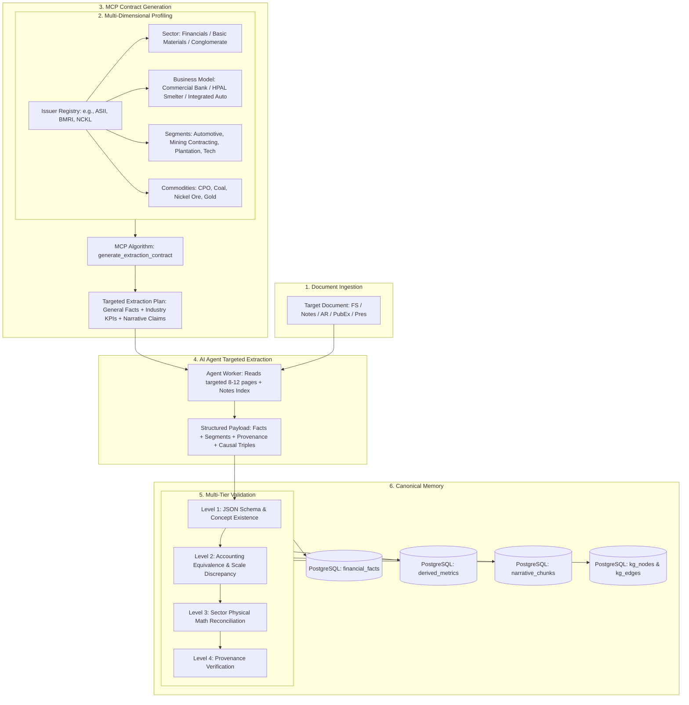
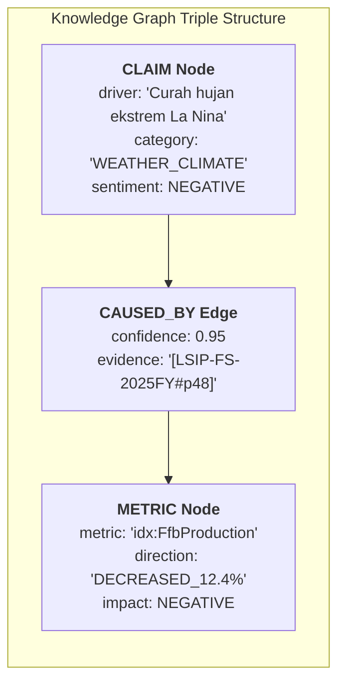
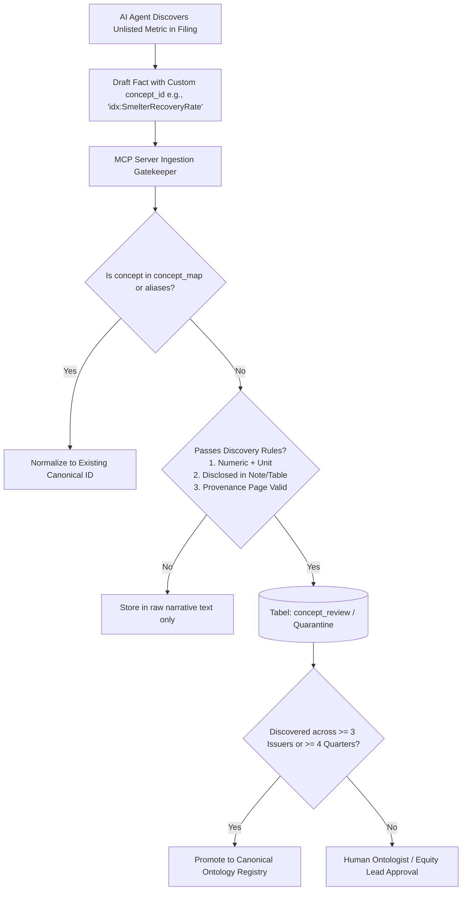
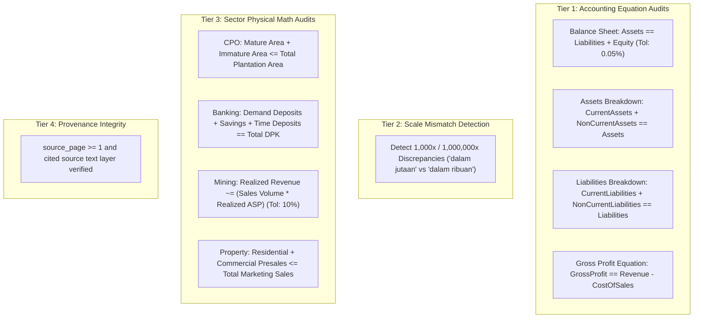
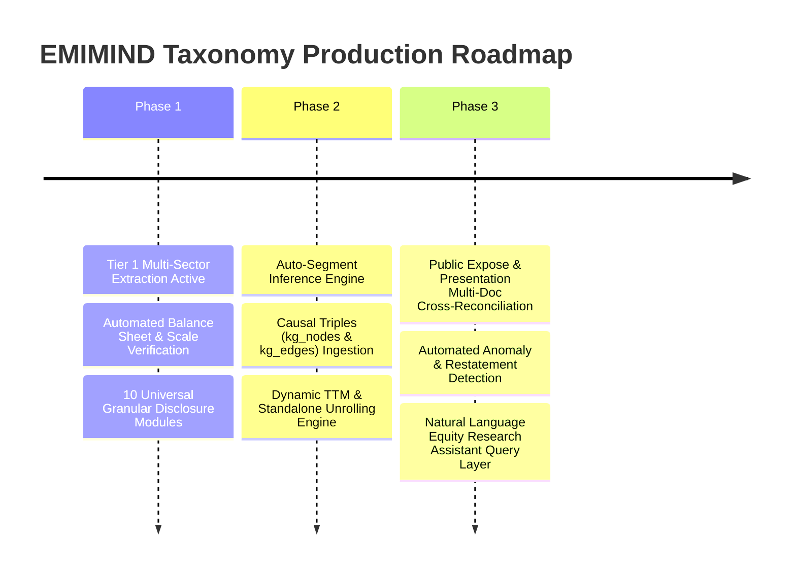

# EMIMIND — Industry-Aware Financial Metric Ontology & Taxonomy Architecture
**Architectural Specification & Research Deliverable**  
*Target Environment: Indonesian Capital Markets (Bursa Efek Indonesia / IDX)*  
*Author: EMIMIND Financial Systems Architecture & Equity Research Ontological Engineering*

---

## EXECUTIVE SUMMARY & ARCHITECTURAL FOUNDATION

The objective of EMIMIND's **Industry-Aware Financial Metric Ontology** is to solve the fundamental limitation of traditional financial data platforms (which treat all companies as flat financial statements) and generic LLM extractors (which perform naive, shallow key-stat scraping).

In Indonesian listed companies (IDX 900+ issuers), **financial numbers without operational context and causal attribution are analytically sterile**:
- A bank cannot be evaluated without **NPL collectibility migration (Kol 1–5), CASA franchise depth, and NIM sensitivity**.
- A nickel smelter (e.g., NCKL, MBMA, ANTM) cannot be valued on Net Income alone without **Saprolite vs. Limonite ore throughput, MHP vs. FeNi recovery rates, and cash cost per Ni ton**.
- A palm oil plantation (e.g., LSIP, TAPG, DSNG) requires **mature vs. immature hectarage profile, FFB yield per hectare, and Oil Extraction Rate (OER)**.
- A property developer (e.g., BSDE, CTRA, PWON) relies on **presales (marketing sales), landbank cost basis in hectares, and recurring mall/hospital cash flows**.

EMIMIND implements a **Multi-Dimensional Orthogonal Classification Engine** coupled with a **Deterministic Calculation DAG** and a **Causal Knowledge Graph**.



---

## SECTION A: RECOMMENDED EMIMIND CLASSIFICATION ARCHITECTURE

### 1. Evaluation of Existing Taxonomies

| Taxonomy | Strengths | Critical Weaknesses for IDX Equity Analysis | Verdict for EMIMIND |
| :--- | :--- | :--- | :--- |
| **IDX-IC (IDX Industrial Classification)** | Mandated by IDX since 2021; 12 Sectors, 35 Sub-sectors, 69 Industries, 130 Sub-industries. | Fails to capture **business model variations** (e.g., pure thermal coal miner vs. mining contractor vs. renewable energy pivot like BUMI/ADRO); fails for diversified conglomerates. | **Primary Regulatory Anchor (Dimension 1)** |
| **GICS (MSCI / S&P)** | Global standard; clean 11 sectors. | Too broad for Indonesian niche dynamics (e.g., CPO lumped into generic Agricultural Products; Nickel HPAL lumped into generic Specialty Chemicals/Metals). | **Secondary Mapping for Global Benchmarking** |
| **ICB / SIC / NAICS** | Detailed code hierarchies. | Out of sync with OJK regulatory reporting frameworks and PSAK statement nomenclature. | **Discard / Reference only** |

### 2. The EMIMIND 6-Dimensional Orthogonal Architecture (Option D)

EMIMIND rejects single-hierarchy classification. A company is classified across **6 Orthogonal Facets**:

```text
Company Entity (e.g., PT Astra International Tbk - ASII)
│
├── Dimension 1: Regulatory Classification (IDX-IC)
│   ├── Sector: Perindustrian (Industrials)
│   ├── Sub-Sector: Barang Perindustrian
│   └── Industry / Sub-Industry: Otomotif & Komponen
│
├── Dimension 2: Primary Business Model Archetype
│   └── Archetype: DIVERSIFIED_CONGLOMERATE (HoldCo with Multi-Operating Subs)
│
├── Dimension 3: Operating Business Segments (Matrix)
│   ├── Segment 1: AUTOMOTIVE (4W/2W Assembly & Distribution, Auto Components)
│   ├── Segment 2: MINING_CONTRACTING_AND_EQUITY (UNTR, PAMA - Heavy Equipment & Mining)
│   ├── Segment 3: FINANCIAL_SERVICES (SANF, ACC, FIF - Multifinance & Banking)
│   ├── Segment 4: AGRIBUSINESS (AALI - Integrated Palm Oil Plantation)
│   ├── Segment 5: INFRASTRUCTURE_LOGISTICS (ASTRA Infra - Toll Roads, Serasi)
│   └── Segment 6: INFORMATION_TECHNOLOGY (Astra Graphia)
│
├── Dimension 4: Commodity & Raw Material Exposure
│   ├── Direct Export Commodity: CPO, Thermal Coal, Gold
│   └── Input Cost Commodity: Steel, Rubber, Aluminum, Lithium/Battery Chem
│
├── Dimension 5: Revenue Driver Mechanism
│   ├── Consumer Discretionary Purchasing Power (4W/2W sales volume)
│   ├── Global Commodity Spot & Contract Prices (Coal ASP, CPO Rotterdam/KPBN)
│   └── Interest Rate Spread / NIM (Consumer financing book)
│
└── Dimension 6: Regulatory Supervision Regime
    └── Hybrid (OJK Capital Markets + OJK IKNB for Multifinance + OJK Banking for Bank Jasa Jakarta)
```

---

## SECTION B: CANONICAL GENERAL METRIC TAXONOMY

These metrics apply across all commercial enterprises (with banking/financials adapting balance sheet/income line items).

| Group | Metric ID | Metric Name (Indonesian / English) | Unit | Data Type | Flow / Stock | Method | Formula / Raw Dependencies | Periodicity | Primary Source |
| :--- | :--- | :--- | :--- | :--- | :--- | :--- | :--- | :--- | :--- |
| **Income** | `ifrs:Revenue` | Pendapatan Usaha / Net Revenue | IDR | Monetary (Decimal) | Flow | Extracted | Line item from Laba Rugi | Q / YTD / FY | FS: Laba Rugi |
| **Income** | `ifrs:CostOfSales` | Beban Pokok Pendapatan / Cost of Goods Sold | IDR | Monetary (Decimal) | Flow | Extracted | Line item from Laba Rugi | Q / YTD / FY | FS: Laba Rugi |
| **Income** | `ifrs:GrossProfit` | Laba Kotor / Gross Profit | IDR | Monetary (Decimal) | Flow | Calculated | `Revenue - CostOfSales` | Q / YTD / FY | FS: Laba Rugi |
| **Income** | `ifrs:OperatingProfit` | Laba Usaha / Operating Profit (EBIT) | IDR | Monetary (Decimal) | Flow | Extracted | Line item from Laba Rugi | Q / YTD / FY | FS: Laba Rugi |
| **Income** | `idx:EBITDA` | EBITDA | IDR | Monetary (Decimal) | Flow | Calculated | `OperatingProfit + Depreciation + Amortisation` | Q / YTD / FY | Hybrid: FS + Notes |
| **Income** | `ifrs:FinanceCosts` | Beban Keuangan / Finance Costs | IDR | Monetary (Decimal) | Flow | Extracted | Line item from Laba Rugi | Q / YTD / FY | FS: Laba Rugi |
| **Income** | `ifrs:ProfitBeforeTax` | Laba Sebelum Pajak / EBT | IDR | Monetary (Decimal) | Flow | Extracted | Line item from Laba Rugi | Q / YTD / FY | FS: Laba Rugi |
| **Income** | `ifrs:ProfitLossAttributableToOwnersOfParent` | Laba Bersih Entitas Induk / Net Income | IDR | Monetary (Decimal) | Flow | Extracted | Line item from Laba Rugi | Q / YTD / FY | FS: Laba Rugi |
| **Balance Sheet** | `ifrs:Assets` | Total Aset / Total Assets | IDR | Monetary (Decimal) | Stock | Extracted | Line item from Neraca | Spot (End of Period) | FS: Neraca |
| **Balance Sheet** | `ifrs:CurrentAssets` | Total Aset Lancar / Current Assets | IDR | Monetary (Decimal) | Stock | Extracted | Line item from Neraca | Spot | FS: Neraca |
| **Balance Sheet** | `ifrs:NonCurrentAssets` | Total Aset Tidak Lancar / Non-Current Assets | IDR | Monetary (Decimal) | Stock | Extracted | Line item from Neraca | Spot | FS: Neraca |
| **Balance Sheet** | `ifrs:CashAndCashEquivalents` | Kas dan Setara Kas / Cash & Equivalents | IDR | Monetary (Decimal) | Stock | Extracted | Line item from Neraca | Spot | FS: Neraca |
| **Balance Sheet** | `ifrs:TradeAndOtherReceivables` | Piutang Usaha / Trade Receivables | IDR | Monetary (Decimal) | Stock | Extracted | Line item from Neraca | Spot | FS: Neraca |
| **Balance Sheet** | `ifrs:Inventories` | Persediaan / Inventories | IDR | Monetary (Decimal) | Stock | Extracted | Line item from Neraca | Spot | FS: Neraca |
| **Balance Sheet** | `ifrs:Liabilities` | Total Liabilitas / Total Liabilities | IDR | Monetary (Decimal) | Stock | Extracted | Line item from Neraca | Spot | FS: Neraca |
| **Balance Sheet** | `ifrs:CurrentLiabilities` | Total Liabilitas Jangka Pendek | IDR | Monetary (Decimal) | Stock | Extracted | Line item from Neraca | Spot | FS: Neraca |
| **Balance Sheet** | `ifrs:NonCurrentLiabilities` | Total Liabilitas Jangka Panjang | IDR | Monetary (Decimal) | Stock | Extracted | Line item from Neraca | Spot | FS: Neraca |
| **Balance Sheet** | `idx:TotalDebt` | Total Utang Berbunga / Total Interest Debt | IDR | Monetary (Decimal) | Stock | Calculated | `ShortTermBorrowings + LongTermBorrowings + BondsPayable + LeaseLiabilities` | Spot | Notes: Utang Bank |
| **Balance Sheet** | `idx:NetDebt` | Utang Bersih / Net Debt | IDR | Monetary (Decimal) | Stock | Calculated | `TotalDebt - CashAndCashEquivalents` | Spot | Calculated |
| **Balance Sheet** | `ifrs:Equity` | Total Ekuitas / Total Equity | IDR | Monetary (Decimal) | Stock | Extracted | Line item from Neraca | Spot | FS: Neraca |
| **Balance Sheet** | `ifrs:EquityAttributableToOwnersOfParent` | Ekuitas Pemilik Entitas Induk | IDR | Monetary (Decimal) | Stock | Extracted | Line item from Neraca | Spot | FS: Neraca |
| **Cash Flow** | `ifrs:CashFlowsFromUsedInOperatingActivities` | Arus Kas Operasi / CFO | IDR | Monetary (Decimal) | Flow | Extracted | Line item from Arus Kas | Q / YTD / FY | FS: Arus Kas |
| **Cash Flow** | `idx:Capex` | Belanja Modal / Capital Expenditures | IDR | Monetary (Decimal) | Flow | Extracted | `PaymentsToAcquirePropertyPlantAndEquipment` | Q / YTD / FY | FS: Arus Kas (Investing) |
| **Cash Flow** | `idx:FreeCashFlow` | Arus Kas Bebas / Free Cash Flow (FCF) | IDR | Monetary (Decimal) | Flow | Calculated | `CFO - Capex` | Q / YTD / FY | Calculated |
| **Cash Flow** | `idx:FreeCashFlowToFirm` | FCFF | IDR | Monetary (Decimal) | Flow | Calculated | `CFO + (FinanceCosts * (1 - TaxRate)) - Capex` | Q / YTD / FY | Calculated |
| **Profitability** | `idx:GrossProfitMargin` | Margin Laba Kotor / GPM | % | Percentage | Ratio | Calculated | `(GrossProfit / Revenue) * 100` | Q / TTM / FY | Calculated |
| **Profitability** | `idx:OperatingProfitMargin` | Margin Laba Usaha / OPM | % | Percentage | Ratio | Calculated | `(OperatingProfit / Revenue) * 100` | Q / TTM / FY | Calculated |
| **Profitability** | `idx:NetProfitMargin` | Margin Laba Bersih / NPM | % | Percentage | Ratio | Calculated | `(NetIncome / Revenue) * 100` | Q / TTM / FY | Calculated |
| **Profitability** | `idx:ReturnOnEquity` | Imbal Hasil Ekuitas / ROE (TTM) | % | Percentage | Ratio | Calculated | `(NetIncome_TTM / Avg_EquityAttributable) * 100` | TTM / FY | Calculated |
| **Profitability** | `idx:ReturnOnAssets` | Imbal Hasil Aset / ROA (TTM) | % | Percentage | Ratio | Calculated | `(NetIncome_TTM / Avg_Assets) * 100` | TTM / FY | Calculated |
| **Solvency** | `idx:DebtToEquityRatio` | Rasio Utang terhadap Ekuitas / DER | x | Multiple | Ratio | Calculated | `TotalDebt / EquityAttributable` | Spot | Calculated |
| **Solvency** | `idx:NetDebtToEBITDA` | Rasio Utang Bersih / EBITDA (TTM) | x | Multiple | Ratio | Calculated | `NetDebt / EBITDA_TTM` | Spot | Calculated |
| **Solvency** | `idx:InterestCoverageRatio` | Rasio Cakupan Bunga / ICR | x | Multiple | Ratio | Calculated | `EBIT_TTM / FinanceCosts_TTM` | TTM / FY | Calculated |
| **Liquidity** | `idx:CurrentRatio` | Rasio Lancar / Current Ratio | x | Multiple | Ratio | Calculated | `CurrentAssets / CurrentLiabilities` | Spot | Calculated |
| **Liquidity** | `idx:QuickRatio` | Rasio Cepat / Acid-Test Ratio | x | Multiple | Ratio | Calculated | `(CurrentAssets - Inventories) / CurrentLiabilities` | Spot | Calculated |
| **Per Share** | `idx:SharesOutstanding` | Jumlah Saham Beredar / Shares Out | SHARES | Integer / Float | Stock | Extracted | Line item from Modal Saham / Neraca | Spot | FS: Neraca / Notes |
| **Per Share** | `ifrs:BasicEarningsLossPerShare` | Laba Bersih per Saham / EPS (Dilaporkan) | IDR | Decimal | Flow | Extracted | Line item from Laba Rugi | Q / YTD / FY | FS: Laba Rugi |
| **Per Share** | `idx:BookValuePerShare` | Nilai Buku per Saham / BVPS | IDR | Decimal | Stock | Calculated | `EquityAttributable / SharesOutstanding` | Spot | Calculated |
| **Per Share** | `idx:CashPerShare` | Kas per Saham / CashPS | IDR | Decimal | Stock | Calculated | `CashAndCashEquivalents / SharesOutstanding` | Spot | Calculated |
| **Per Share** | `idx:FreeCashFlowPerShare` | FCF per Saham / FCFPS | IDR | Decimal | Flow | Calculated | `FreeCashFlow_TTM / SharesOutstanding` | TTM / FY | Calculated |
| **Valuation** | `idx:MarketCapitalization` | Kapitalisasi Pasar / Market Cap | IDR | Monetary (Decimal) | Stock | Calculated | `SharePrice * SharesOutstanding` | Daily / Spot | Market Feed |
| **Valuation** | `idx:EnterpriseValue` | Nilai Perusahaan / EV | IDR | Monetary (Decimal) | Stock | Calculated | `MarketCap + TotalDebt + NonControllingInterest - Cash` | Daily / Spot | Calculated |
| **Valuation** | `idx:PriceToEarningsRatio` | Rasio Harga Laba / PER (TTM) | x | Multiple | Ratio | Calculated | `SharePrice / EPS_TTM` | Daily / Spot | Market + Calculated |
| **Valuation** | `idx:PriceToBookValue` | Rasio Harga Buku / PBV | x | Multiple | Ratio | Calculated | `SharePrice / BVPS` | Daily / Spot | Market + Calculated |
| **Valuation** | `idx:EVToEBITDA` | Rasio EV / EBITDA (TTM) | x | Multiple | Ratio | Calculated | `EnterpriseValue / EBITDA_TTM` | Daily / Spot | Market + Calculated |
| **Dividend** | `idx:DividendPerShare` | Dividen per Saham / DPS | IDR | Decimal | Flow | Extracted | RUPS / Keterbukaan Informasi | Event-based | IDX Disclosure |
| **Dividend** | `idx:DividendYield` | Yield Dividen / Div Yield | % | Percentage | Ratio | Calculated | `(DPS_Annual / SharePrice) * 100` | Daily / Spot | Market + Calculated |
| **Dividend** | `idx:DividendPayoutRatio` | Rasio Pembayaran Dividen / DPR | % | Percentage | Ratio | Calculated | `(TotalDividendsPaid / NetIncome_FY) * 100` | Annual | Calculated |

---

## SECTION C: INDUSTRY-SPECIFIC METRIC TAXONOMY (ALL 11 IDX SECTORS)

```mermaid
graph LR
    subgraph IDX_11_Sectors [IDX 11 Sectors]
        S1[1. Financials / Banking]
        S2[2. Energy: Coal & Oil Gas]
        S3[3. Basic Materials: Nickel & Metals]
        S4[4. Consumer Non-Cyclicals: CPO & F&B]
        S5[5. Consumer Cyclicals: Auto & Retail]
        S6[6. Properties & Real Estate]
        S7[7. Infrastructure: Telco & Towers]
        S8[8. Healthcare & Hospitals]
        S9[9. Transportation & Logistics]
        S10[10. Industrials & Machinery]
        S11[11. Technology & Digital]
    end
```



---

### 1. SECTOR: FINANCIALS (Perbankan & Lembaga Keuangan)

#### A. Sub-Industry: Commercial Banking (Bank Umum: BMRI, BBCA, BBRI, BBNI, BDMN, BBTN)

| Metric ID | Metric Name | Category | Importance | Unit | Freq | Primary Source | Secondary Source | Mode |
| :--- | :--- | :--- | :--- | :--- | :--- | :--- | :--- | :--- |
| `idx:LoansAndAdvances` | Total Kredit yang Diberikan (Gross) | Balance Sheet | **CRITICAL** | IDR | Q | FS: Neraca | Notes: Kredit | EXTRACTED |
| `idx:CustomerDeposits` | Total Dana Pihak Ketiga (DPK) | Balance Sheet | **CRITICAL** | IDR | Q | FS: Neraca | Notes: DPK | EXTRACTED |
| `idx:DemandDeposits` | Giro (Demand Deposits) | Balance Sheet | **HIGH** | IDR | Q | FS: Neraca / Notes | PubEx | EXTRACTED |
| `idx:SavingsDeposits` | Tabungan (Savings Deposits) | Balance Sheet | **HIGH** | IDR | Q | FS: Neraca / Notes | PubEx | EXTRACTED |
| `idx:TimeDeposits` | Deposito Berjangka (Time Deposits) | Balance Sheet | **HIGH** | IDR | Q | FS: Neraca / Notes | PubEx | EXTRACTED |
| `idx:CASA` | Total Dana Murah (CASA = Giro + Tabungan) | Balance Sheet | **CRITICAL** | IDR | Q | Notes: DPK | Calculated | HYBRID |
| `idx:CASARatio` | Rasio Dana Murah (CASA / DPK) | Liquidity | **CRITICAL** | % | Q | Presentation / PubEx | Notes: DPK | HYBRID (`CASA/DPK*100`) |
| `idx:LoanToDepositRatio` | LDR / Loan to Deposit Ratio | Liquidity | **CRITICAL** | % | Q | Presentation / PubEx | FS: Neraca | HYBRID (`Loans/DPK*100`) |
| `idx:NetInterestIncome` | Pendapatan Bunga Bersih (NII) | Income | **CRITICAL** | IDR | Q | FS: Laba Rugi | Notes: Bunga | EXTRACTED |
| `idx:NetInterestMargin` | Margin Bunga Bersih (NIM) | Profitability | **CRITICAL** | % | Q | Presentation / PubEx | Annual Report | EXTRACTED |
| `idx:NonPerformingLoansGross` | Kredit Bermasalah (NPL Gross) | Asset Quality | **CRITICAL** | IDR | Q | Notes: Kolektibilitas | Presentation | EXTRACTED |
| `idx:NPLGrossRatio` | Rasio NPL Gross (%) | Asset Quality | **CRITICAL** | % | Q | Presentation / PubEx | Notes: Kualitas Aset | EXTRACTED |
| `idx:NPLNetRatio` | Rasio NPL Net (%) | Asset Quality | **HIGH** | % | Q | Presentation / PubEx | Notes: Kualitas Aset | EXTRACTED |
| `idx:SpecialMentionLoans` | Kredit Kurang Lancar (Kol 2 / DPK) | Asset Quality | **HIGH** | IDR | Q | Notes: Kolektibilitas | Presentation | EXTRACTED |
| `idx:LoanAtRisk` | Loan at Risk (LAR) Termasuk Restrukturisasi | Asset Quality | **HIGH** | % | Q | Presentation / PubEx | Annual Report | EXTRACTED |
| `idx:NPLCoverageRatio` | Rasio Pencadangan NPL (CKPN / NPL) | Asset Quality | **HIGH** | % | Q | Presentation / PubEx | Notes: Cadangan Penurunan | HYBRID |
| `idx:CreditCost` | Cost of Credit (CoC / Beban CKPN / Rata-rata Kredit) | Asset Quality | **CRITICAL** | % | Q | Presentation / PubEx | Notes: Provisi | EXTRACTED |
| `idx:CapitalAdequacyRatio` | Rasio Kecukupan Modal (CAR / KPMM) | Capital | **CRITICAL** | % | Q | Notes: Modal & Rasio | Presentation | EXTRACTED |
| `idx:Tier1CAR` | Rasio Modal Inti (Tier 1 CAR) | Capital | **HIGH** | % | Q | Notes: Modal & Rasio | Presentation | EXTRACTED |
| `idx:CostToIncomeRatio` | Rasio Beban Operasional / Pendapatan (BOPO / CIR) | Efficiency | **HIGH** | % | Q | Presentation / PubEx | Notes: Rasio | EXTRACTED |
| `idx:FeeBasedIncome` | Pendapatan Non-Bunga / Fee-Based Income | Income | **HIGH** | IDR | Q | FS: Laba Rugi | Notes: Provisi & Komisi | EXTRACTED |
| `idx:DigitalAppUsers` | Pengguna Aplikasi Mobile / Digital (Livin, BCA Mobile) | Operational | **MEDIUM** | USERS | Q / PubEx | Investor Presentation | Public Expose | EXTRACTED |

#### B. Sub-Industry: Multifinance & Consumer Credit (ADMF, BFIN, CFIN)
- `idx:TotalFinancingReceivables` (Piutang Pembiayaan Konsumen) [CRITICAL, IDR, FS: Neraca]
- `idx:FinancingNPF` (Non-Performing Financing / NPF Gross %) [CRITICAL, %, Notes: Pembiayaan]
- `idx:GearingRatio` (Rasio Gearing / Utang Pinjaman terhadap Modal Bersih) [CRITICAL, x, Notes: Rasio Keuangan]
- `idx:AverageFundingCost` (Biaya Rata-rata Pendanaan Bank & Obligasi) [HIGH, %, Presentation]

---

### 2. SECTOR: BASIC MATERIALS (Nikel, Tambang Mineral, Semen, Kimia)

#### A. Sub-Industry: Nickel Mining & HPAL Smelting (NCKL, MBMA, INCO, ANTM)

| Metric ID | Metric Name | Category | Importance | Unit | Freq | Primary Source | Secondary Source | Mode |
| :--- | :--- | :--- | :--- | :--- | :--- | :--- | :--- | :--- |
| `idx:NickelOreProduction` | Volume Produksi Bijih Nikel (Saprolite + Limonite) | Operational | **CRITICAL** | WMT | Q | Presentation / PubEx | Notes: Segmen | EXTRACTED |
| `idx:SaproliteOreSales` | Volume Penjualan Saprolite (High-Grade Ore ke RKEF) | Operational | **HIGH** | WMT | Q | Presentation / PubEx | Notes: Segmen | EXTRACTED |
| `idx:LimoniteOreSales` | Volume Penjualan Limonite (Low-Grade Ore ke HPAL) | Operational | **HIGH** | WMT | Q | Presentation / PubEx | Notes: Segmen | EXTRACTED |
| `idx:FerronickelProduction` | Produksi FeNi / NPI (Ferronickel / Nickel Pig Iron) | Operational | **CRITICAL** | TONNES Ni | Q | Presentation / PubEx | Annual Report | EXTRACTED |
| `idx:MHPProduction` | Produksi Mixed Hydroxide Precipitate (MHP) | Operational | **CRITICAL** | TONNES Ni | Q | Presentation / PubEx | Annual Report | EXTRACTED |
| `idx:NickelMatteProduction` | Produksi Nikel Matte (e.g. INCO) | Operational | **HIGH** | TONNES Ni | Q | Presentation / PubEx | Annual Report | EXTRACTED |
| `idx:NickelASP` | Harga Jual Rata-rata Nikel (Realized ASP per Ton) | Market / Operational | **CRITICAL** | USD/TON | Q | Presentation / PubEx | Notes: Pendapatan | EXTRACTED |
| `idx:NickelCashCost` | Cash Cost Produksi Nikel per Ton (C1 / C2 Cash Cost) | Operational | **CRITICAL** | USD/TON | Q | Presentation / PubEx | Notes: Beban Pokok | EXTRACTED |
| `idx:SmelterCapacityRKEF` | Kapasitas Terpasang Smelter RKEF / Line | Operational | **HIGH** | LINE / TON | Annual / PubEx | Presentation / AR | PubEx | EXTRACTED |
| `idx:SmelterCapacityHPAL` | Kapasitas Terpasang Smelter HPAL MHP | Operational | **CRITICAL** | TONNES Ni | Annual / PubEx | Presentation / AR | PubEx | EXTRACTED |
| `idx:SmelterUtilizationRate` | Utilisasi Kapasitas Smelter (%) | Operational | **HIGH** | % | Q / PubEx | Investor Presentation | PubEx | EXTRACTED |
| `idx:MiningReservesMt` | Cadangan Bijih Nikel JORC (Proved & Probable) | Reserves | **CRITICAL** | MT | Annual | Annual Report | ESDM Filing | EXTRACTED |
| `idx:MiningResourcesMt` | Sumber Daya Nikel JORC (Measured, Indicated, Inferred) | Reserves | **HIGH** | MT | Annual | Annual Report | ESDM Filing | EXTRACTED |
| `idx:MiningConcessionArea` | Luas Konsesi Tambang (IUP Operasi Produksi) | Concession | **MEDIUM** | HECTARES | Annual | Notes 1: Umum | Annual Report | EXTRACTED |

#### B. Sub-Industry: Cement (Semen: SMGR, INTP)
- `idx:CementSalesVolume` (Volume Penjualan Semen Domestik & Ekspor) [CRITICAL, MT, Presentation/PubEx]
- `idx:CementASP` (Harga Rata-rata Semen per Sak / per Ton) [HIGH, IDR/Ton, Presentation]
- `idx:DomesticMarketShare` (Pangsa Pasar Semen Domestik %) [HIGH, %, Presentation/ASI]
- `idx:ClinkerProduction` (Produksi Klinker & Utilisasi Pabrik %) [HIGH, MT, Annual Report]
- `idx:EnergyCostPerTon` (Biaya Bahan Bakar Batubara & Listrik per Ton Semen) [HIGH, IDR/Ton, Notes: COGS]

---

### 3. SECTOR: ENERGY (Batubara, Minyak & Gas, Jasa Tambang)

#### A. Sub-Industry: Thermal & Metallurgical Coal Mining (ADRO, PTBA, ITMG, BUMI, INDY, UNTR)

| Metric ID | Metric Name | Category | Importance | Unit | Freq | Primary Source | Secondary Source | Mode |
| :--- | :--- | :--- | :--- | :--- | :--- | :--- | :--- | :--- |
| `idx:CoalProductionVolume` | Volume Produksi Batubara (Production Volume) | Operational | **CRITICAL** | MT | Q | Presentation / PubEx | Notes: Segmen | EXTRACTED |
| `idx:CoalSalesVolume` | Volume Penjualan Batubara (Sales Volume) | Operational | **CRITICAL** | MT | Q | Presentation / PubEx | Notes: Segmen | EXTRACTED |
| `idx:DomesticMarketObligation` | Volume Pasokan DMO Domestik (PLN Cap USD 70/t) | Operational | **HIGH** | MT / % | Q | Presentation / PubEx | Notes: Segmen | EXTRACTED |
| `idx:ExportSalesVolume` | Volume Penjualan Ekspor (China, India, Japan, etc.) | Operational | **HIGH** | MT | Q | Presentation / PubEx | Notes: Segmen | EXTRACTED |
| `idx:AverageSellingPrice` | Realized Average Selling Price (ASP Batubara) | Market | **CRITICAL** | USD/TON | Q | Presentation / PubEx | Notes: Pendapatan | EXTRACTED |
| `idx:StripRatio` | Nisbah Kupas (Overburden Removal to Coal Ratio) | Operational | **CRITICAL** | BCM/TON | Q | Presentation / PubEx | Annual Report | EXTRACTED |
| `idx:OverburdenRemoval` | Total Pengupasan Lapisan Tanah Penutup (OB Removal) | Operational | **HIGH** | BCM | Q | Presentation / PubEx | Notes: Jasa Tambang | EXTRACTED |
| `idx:CashCostPerTon` | Free-on-Board (FOB) Cash Cost per Ton Batubara | Operational | **CRITICAL** | USD/TON | Q | Presentation / PubEx | Notes: Beban Pokok | EXTRACTED |
| `idx:MiningRoyalties` | Beban Royalti & Iuran Produksi Pemerintah (PNBP) | Cost/Govt | **HIGH** | IDR / USD | Q | FS: Laba Rugi | Notes: Beban Pokok | EXTRACTED |
| `idx:CoalCalorificValue` | Nilai Kalori Batubara Rata-rata (GAR / NAR) | Quality | **MEDIUM** | KCAL/KG | Annual / PubEx | Presentation / AR | PubEx | EXTRACTED |
| `idx:CoalReservesMt` | Cadangan Batubara JORC (Proved & Probable) | Reserves | **CRITICAL** | MT | Annual | Annual Report | Technical Report | EXTRACTED |

#### B. Sub-Industry: Oil & Gas Exploration & Production (MEDC, ENRG, ELSA)
- `idx:OilProduction` (Produksi Minyak Mentah / BOPD) [CRITICAL, BOPD, Presentation/Notes]
- `idx:GasProduction` (Produksi Gas Bumi / MMSCFD) [CRITICAL, MMSCFD, Presentation/Notes]
- `idx:OilRealizedPrice` (Realized Price Minyak / ICP vs Brent) [CRITICAL, USD/BBL, Notes: Pendapatan]
- `idx:GasRealizedPrice` (Realized Price Gas / USD per MMBTU) [CRITICAL, USD/MMBTU, Notes: Pendapatan]
- `idx:Net2PReserves` (Cadangan Terbukti & Terduga 2P Oil & Gas) [CRITICAL, MMBOE, Annual Report]
- `idx:LiftingCostPerBOE` (Biaya Operasi Pengangkatan / Unit Lifting Cost) [HIGH, USD/BOE, Presentation]

---

### 4. SECTOR: CONSUMER NON-CYCLICALS (Perkebunan Sawit, F&B, Unggas, Rokok)

#### A. Sub-Industry: Palm Oil Plantation (CPO: LSIP, TAPG, DSNG, AALI, SSMS, SIMP)

| Metric ID | Metric Name | Category | Importance | Unit | Freq | Primary Source | Secondary Source | Mode |
| :--- | :--- | :--- | :--- | :--- | :--- | :--- | :--- | :--- |
| `idx:TotalPlantationArea` | Total Luas Area Perkebunan (Titling / HGU) | Operational | **HIGH** | HECTARES | Annual / Q | Notes: Tanaman Produktif | Annual Report | EXTRACTED |
| `idx:MaturePlantedArea` | Luas Tanaman Menghasilkan (Mature Plantation) | Operational | **CRITICAL** | HECTARES | Q / Annual | Notes: Aset Biologis | Presentation | EXTRACTED |
| `idx:ImmaturePlantedArea` | Luas Tanaman Belum Menghasilkan (Immature) | Operational | **HIGH** | HECTARES | Q / Annual | Notes: Aset Biologis | Presentation | EXTRACTED |
| `idx:PlasmaPlantedArea` | Luas Kebun Kemitraan / Plasma | Operational | **MEDIUM** | HECTARES | Annual | Notes: Aset Biologis | Annual Report | EXTRACTED |
| `idx:AveragePlantationAge` | Profil Umur Rata-rata Pohon Kelapa Sawit | Profile | **HIGH** | YEARS | Annual | Investor Presentation | Annual Report | EXTRACTED |
| `idx:FfbProduction` | Produksi Tandan Buah Segar (FFB Production - Internal) | Operational | **CRITICAL** | TONNES | Q | Presentation / PubEx | Notes: Segmen | EXTRACTED |
| `idx:FfbExternalPurchased` | Pembelian TBS Pihak Ketiga / Petani Luar | Operational | **MEDIUM** | TONNES | Q | Notes: Beban Pokok | Presentation | EXTRACTED |
| `idx:FfbYieldPerHectare` | Produktivitas Kebun (FFB Yield per Hektar) | Efficiency | **CRITICAL** | TON/HA | Q / Annual | Investor Presentation | PubEx | EXTRACTED |
| `idx:CpoProduction` | Produksi Minyak Kelapa Sawit (CPO Output) | Operational | **CRITICAL** | TONNES | Q | Presentation / PubEx | Notes: Segmen | EXTRACTED |
| `idx:PalmKernelProduction` | Produksi Inti Sawit (Palm Kernel / PK Output) | Operational | **HIGH** | TONNES | Q | Presentation / PubEx | Notes: Segmen | EXTRACTED |
| `idx:OilExtractionRate` | Tingkat Ekstraksi Minyak Sawit (OER %) | Efficiency | **CRITICAL** | % | Q | Investor Presentation | PubEx | EXTRACTED |
| `idx:KernelExtractionRate` | Tingkat Ekstraksi Inti Sawit (KER %) | Efficiency | **MEDIUM** | % | Q | Investor Presentation | PubEx | EXTRACTED |
| `idx:CpoRealizedASP` | Realized Average Selling Price CPO (FOB Belawan/Dumai) | Market | **CRITICAL** | IDR/KG | Q | Presentation / PubEx | Notes: Penjualan | EXTRACTED |
| `idx:CpoCashCostPerKg` | Ex-Mill Cash Cost CPO per Kilogram (inc. pupuk & upah) | Cost | **CRITICAL** | IDR/KG | Q / Annual | Investor Presentation | Notes: Beban Pokok | EXTRACTED |
| `idx:PalmOilMillCapacity` | Kapasitas Pengolahan Pabrik Kelapa Sawit (PKS) | Operational | **HIGH** | FFB TON/HOUR | Annual | Notes 1: Umum | Annual Report | EXTRACTED |

#### B. Sub-Industry: Consumer Staples & Packaged Food (ICBP, INDF, MYOR, UNVR, CMRY)
- `idx:VolumeSalesPackagedFood` (Volume Penjualan Makanan Kemasan / Karton / Packs) [HIGH, UNITS/PACKS, Presentation]
- `idx:RawMaterialCostWheat` (Beban Bahan Baku Gandum / Terigu) [HIGH, IDR, Notes: Beban Pokok]
- `idx:RawMaterialCostMilk` (Beban Bahan Baku Susu Segar & Bubuk) [HIGH, IDR, Notes: Beban Pokok]
- `idx:ModernVsGeneralTrade` (Proporsi Penjualan Modern Trade vs Pasar Tradisional %) [MEDIUM, %, Presentation]
- `idx:AdvertisingPromotionExpense` (Beban Iklan dan Promosi / A&P Ratio %) [HIGH, IDR / %, Notes: Beban Penjualan]

#### C. Sub-Industry: Poultry & Animal Feed (CPIN, JPFA, MAIN)
- `idx:FeedmillSalesVolume` (Volume Penjualan Pakan Ternak) [CRITICAL, MT, Presentation/Notes]
- `idx:DayOldChickVolume` (Volume Penjualan DOC Ayam Broiler & Layer) [CRITICAL, HEADS, Presentation/Notes]
- `idx:BroilerLiveBirdPrice` (Harga Ayam Hidup Komersial per Kg di Farm Gate) [CRITICAL, IDR/KG, Presentation/PubEx]
- `idx:CornRawMaterialCost` (Biaya Jagung Pakan Lokal & Impor) [CRITICAL, IDR/KG, Notes: Beban Pokok]
- `idx:SoybeanMealCost` (Biaya Bungkil Kedelai / SBM Impor) [CRITICAL, USD/IDR, Notes: Beban Pokok]

---

### 5. SECTOR: PROPERTIES & REAL ESTATE (Pengembang Properti & Kawasan Industri)

#### Sub-Industry: Property Developers & Industrial Estates (BSDE, CTRA, PWON, SMRA, DMAS, SSIA)

| Metric ID | Metric Name | Category | Importance | Unit | Freq | Primary Source | Secondary Source | Mode |
| :--- | :--- | :--- | :--- | :--- | :--- | :--- | :--- | :--- |
| `idx:MarketingSalesPresales` | Realisasi Pra-Penjualan (Marketing Sales / Presales) | Operational | **CRITICAL** | IDR | Q | Presentation / PubEx | IDX Disclosure | EXTRACTED |
| `idx:PresalesResidential` | Presales Rumah Tapak (Landed Housing) | Operational | **HIGH** | IDR | Q | Presentation / PubEx | Annual Report | EXTRACTED |
| `idx:PresalesCommercial` | Presales Ruko & Lahan Komersial | Operational | **HIGH** | IDR | Q | Presentation / PubEx | Annual Report | EXTRACTED |
| `idx:PresalesIndustrial` | Presales Lahan Kawasan Industri (Industrial Land) | Operational | **HIGH** | IDR / HA | Q | Presentation / PubEx | Notes: Segmen | EXTRACTED |
| `idx:PresalesHighRise` | Presales Apartemen & Kondominium | Operational | **MEDIUM** | IDR | Q | Presentation / PubEx | Annual Report | EXTRACTED |
| `idx:TotalLandbankHectares` | Total Cadangan Lahan Bersih (Gross & Net Landbank) | Landbank | **CRITICAL** | HECTARES | Q / Annual | Investor Presentation | Notes: Persediaan | EXTRACTED |
| `idx:LandbankAcquisitionHa` | Penambahan / Akuisisi Lahan Baru (Ha) | Landbank | **HIGH** | HECTARES | Q / Annual | Presentation / PubEx | FS: Arus Kas | EXTRACTED |
| `idx:LandbankCostPerSqm` | Rata-rata Nilai Buku Cadangan Lahan per m2 | Valuation | **HIGH** | IDR/M2 | Annual | Notes: Persediaan Tanah | Presentation | EXTRACTED |
| `idx:AverageSellingPriceProperty`| Harga Jual Rata-rata Lahan / Properti per m2 (ASP) | Market | **HIGH** | IDR/M2 | Q | Presentation / PubEx | Annual Report | EXTRACTED |
| `idx:RecurringRevenue` | Pendapatan Berulang (Recurring Income: Mall, Hotel, Office) | Income | **CRITICAL** | IDR | Q | FS: Notes Segmen | Presentation | EXTRACTED |
| `idx:RecurringIncomeShare` | Proporsi Pendapatan Berulang (% dari Total Revenue) | Income | **CRITICAL** | % | Q | Presentation / Notes | Calculated | HYBRID |
| `idx:MallOccupancyRate` | Rata-rata Tingkat Keterisian Mall / Pusat Perbelanjaan | Operational | **HIGH** | % | Q / Annual | Investor Presentation | Annual Report | EXTRACTED |
| `idx:MallNetLeasableArea` | Total Luas Area Bersih yang Disewakan (NLA Mall) | Capacity | **HIGH** | M2 | Annual | Investor Presentation | Annual Report | EXTRACTED |
| `idx:UnbilledRevenue` | Pendapatan Belum Ditagih (Unearned / Backlog Revenue) | Revenue Pipeline | **CRITICAL** | IDR | Q | Notes: Pendapatan Diterima Dimuka | Presentation | EXTRACTED |

---

### 6. SECTOR: INFRASTRUCTURE (Telekomunikasi, Menara, Jalan Tol)

#### A. Sub-Industry: Telecommunications & Digital Network (TLKM, ISAT, EXCL)
- `idx:SubscriberCount` (Total Pelanggan Prabayar & Pascabayar) [CRITICAL, USERS, Presentation/PubEx]
- `idx:ArpuBlended` (Average Revenue Per User / ARPU Blended) [CRITICAL, IDR/Month, Presentation/PubEx]
- `idx:DataTrafficPetabytes` (Total Trafik Lalu Lintas Data) [CRITICAL, PETABYTES, Presentation/PubEx]
- `idx:DataRevenue` (Pendapatan Layanan Data & Internet) [CRITICAL, IDR, FS: Laba Rugi/Notes]
- `idx:FTTHHomepass` (Homepass Fiber-to-the-Home / Indihome/FirstMedia) [HIGH, HOMEPASS, Presentation]
- `idx:FTTHSubscribers` (Pelanggan Fixed Broadband) [HIGH, SUBS, Presentation]
- `idx:TotalBTSCount` (Jumlah Menara Pemancar BTS 4G / 5G) [HIGH, UNITS, Presentation/Notes]

#### B. Sub-Industry: Telecommunication Towers (TOWR, TBIG, MTEL)
- `idx:TowerCount` (Jumlah Menara Fisik Milik Perusahaan) [CRITICAL, SITES, Presentation/Notes]
- `idx:TenancyCount` (Jumlah Penyewa Operator Telekomunikasi / Tenants) [CRITICAL, TENANTS, Presentation/Notes]
- `idx:TenancyRatio` (Rasio Penyewa per Menara = Tenants / Towers) [CRITICAL, x, Presentation/Calculated]
- `idx:FiberOpticRouteKm` (Panjang Jaringan Fiber Optik Terpasang) [HIGH, KM, Presentation/Notes]
- `idx:LeaseContractBacklog` (Total Nilai Kontrak Sewa Jangka Panjang Mengikat) [CRITICAL, IDR, Notes: Komitmen]

#### C. Sub-Industry: Toll Road Operators (JSMR)
- `idx:TollRoadLengthInOperation` (Panjang Ruas Tol Beroperasi) [CRITICAL, KM, Presentation/AR]
- `idx:DailyAverageTraffic` (Volume Lalu Lintas Transaksi Harian Rata-rata / LHR) [CRITICAL, VEHICLES/DAY, Presentation/PubEx]
- `idx:TollTariffAdjustments` (Penyesuaian Tarif Tol Reguler Dua Tahunan) [HIGH, Event-based, IDX Disclosure]

---

### 7. SECTOR: HEALTHCARE (Rumah Sakit & Farmasi)

#### Sub-Industry: Hospital Operators (MIKA, SILO, HEAL, PRDA)
- `idx:OperationalBedsCount` (Jumlah Tempat Tidur Operasional) [CRITICAL, BEDS, Presentation/Notes]
- `idx:BedOccupancyRate` (Tingkat Keterisian Tempat Tidur / BOR %) [CRITICAL, %, Presentation/PubEx]
- `idx:InpatientDays` (Jumlah Hari Rawat Inap Pasien) [HIGH, DAYS, Presentation/PubEx]
- `idx:OutpatientVisits` (Jumlah Kunjungan Pasien Rawat Jalan) [HIGH, VISITS, Presentation/PubEx]
- `idx:AverageRevenuePerInpatientDay` (ARPOB / Pendapatan per Hari Rawat Inap) [CRITICAL, IDR/DAY, Presentation]
- `idx:AverageRevenuePerOutpatient` (ARPO / Pendapatan per Kunjungan Poliklinik) [HIGH, IDR/VISIT, Presentation]
- `idx:BPJSRevenueShare` (Porsi Pasien JKN / BPJS Kesehatan terhadap Pendapatan %) [HIGH, %, Notes: Segmen/Presentation]

---

### 8. SECTOR: TRANSPORTATION & LOGISTICS (Pelayaran, Maskapai, Logistik Darat)

#### Sub-Industry: Marine Shipping & Bulk Logistics (SMDR, TMAS, BESS, HAIS)
- `idx:VesselFleetCount` (Jumlah Armada Kapal Beroperasi: Container, Bulk, Tug & Barge) [CRITICAL, VESSELS, Presentation/Notes]
- `idx:DeadWeightTonnageDwt` (Kapasitas Angkut Armada dalam Deadweight Tonnage) [CRITICAL, DWT, Presentation/AR]
- `idx:ContainerVolumeTeus` (Volume Petikemas Terangkut dalam TEUs) [CRITICAL, TEUS, Presentation/PubEx]
- `idx:CharterRatesPerDay` (Tarif Sewa Kapal Harian / Time Charter Equivalent Rate) [HIGH, USD/DAY, Notes: Pendapatan]
- `idx:BunkerFuelCost` (Beban Bahan Bakar Minyak Kapal / Marine Fuel Oil) [CRITICAL, IDR / USD, Notes: Beban Pokok]

---

## SECTION D: NARRATIVE & CAUSAL FACT ONTOLOGY

Numeric metrics without qualitative attribution fail to explain valuation inflections. EMIMIND implements a **First-Class Qualitative Extraction Model** backed by **PostgreSQL Knowledge Graph Triples (`kg_nodes` and `kg_edges`)**.



### 1. Narrative Classification Taxonomy

| Narrative Category Code | Description | Typical Document Source | Example Text in IDX Filings |
| :--- | :--- | :--- | :--- |
| `BUSINESS_DRIVER` | Faktor operasional internal yang menggerakkan kenaikan/penurunan volume/margin. | Notes: Segmen / MD&A | *"Kenaikan laba usaha didorong oleh efisiensi rute dan penambahan 3 armada kapal baru."* |
| `COMMODITY_PRICE` | Fluktuasi harga acuan komoditas global atau tarif acuan. | PubEx / Notes: Risiko | *"Penurunan pendapatan disebabkan oleh koreksi harga rata-rata nikel LME dari $21.000 menjadi $16.500/ton."* |
| `WEATHER_CLIMATE` | Pengaruh cuaca (El Nino, La Nina, banjir tambang, curah hujan tinggi). | Notes: Biologis / MD&A | *"Produksi TBS kuartal II mengalami penurunan akibat curah hujan tinggi yang menghambat aktivitas panen."* |
| `REGULATORY_CHANGE` | Regulasi pemerintah (DMO batubara, royalti ESDM, tarif cukai rokok, pajak ekspor CPO). | PubEx / Notes: Pajak | *"Penerapan tarif royalti progresif baru PP 26/2022 meningkatkan beban iuran produksi sebesar 3.2%."* |
| `MANAGEMENT_GUIDANCE` | Target resmi manajemen untuk target tahun berjalan (produksi, capex, dividen). | Investor Presentation / PubEx | *"Manajemen menargetkan produksi batubara tahun 2026 sebesar 65-68 juta ton dengan capex USD 250 juta."* |
| `LITIGATION_CONTINGENCY`| Sengketa pajak, sengketa lahan konsesi, tuntutan hukum material. | Notes: Kontinjensi & Peristiwa | *"Perusahaan sedang mengajukan banding atas SKPKB Pajak Penghasilan Badan tahun pajak 2022 sebesar Rp120 miliar."* |
| `CAPITAL_ALLOCATION` | Keputusan merger, akuisisi anak usaha, restrukturisasi utang, buyback saham. | Keterbukaan Informasi / AR | *"Akuisisi 51% saham PT Smelter Obi telah selesai pada Mei 2026 dengan nilai transaksi Rp4.2 triliun."* |

---

## SECTION E: METRIC ONTOLOGY SCHEMA (JSON SCHEMA)

```json
{
  "$schema": "https://json-schema.org/draft/2020-12/schema",
  "title": "EmimindMetricDefinition",
  "type": "object",
  "required": [
    "metric_id",
    "name_en",
    "name_id",
    "category",
    "sector_applicability",
    "importance",
    "value_type",
    "unit",
    "flow_stock_type",
    "extraction_mode",
    "source_priority"
  ],
  "properties": {
    "metric_id": {
      "type": "string",
      "pattern": "^(ifrs|idx):[A-Za-z0-9_]+$",
      "example": "idx:CASARatio"
    },
    "name_en": { "type": "string", "example": "CASA Ratio" },
    "name_id": { "type": "string", "example": "Rasio Dana Murah (CASA)" },
    "category": {
      "type": "string",
      "enum": ["INCOME", "BALANCE_SHEET", "CASH_FLOW", "PROFITABILITY", "LIQUIDITY", "SOLVENCY", "ASSET_QUALITY", "CAPITAL", "OPERATIONAL", "RESERVES", "PER_SHARE", "VALUATION"]
    },
    "sector_applicability": {
      "type": "array",
      "items": { "type": "string" },
      "example": ["FINANCIALS", "BANK"]
    },
    "importance": {
      "type": "string",
      "enum": ["CRITICAL", "HIGH", "MEDIUM", "LOW", "OPTIONAL"]
    },
    "value_type": {
      "type": "string",
      "enum": ["MONETARY", "PERCENTAGE", "MULTIPLE", "INTEGER", "FLOAT", "DATE", "TEXT"]
    },
    "unit": {
      "type": "string",
      "example": "PERCENT"
    },
    "flow_stock_type": {
      "type": "string",
      "enum": ["FLOW_PERIOD", "STOCK_POINT_IN_TIME", "RATIO", "EVENT"]
    },
    "extraction_mode": {
      "type": "string",
      "enum": ["EXTRACTED_RAW", "CALCULATED_DETERMINISTIC", "HYBRID_FALLBACK"]
    },
    "calculation_formula": {
      "type": "string",
      "example": "(idx:CASA / idx:CustomerDeposits) * 100"
    },
    "dependencies": {
      "type": "array",
      "items": { "type": "string" },
      "example": ["idx:DemandDeposits", "idx:SavingsDeposits", "idx:CustomerDeposits"]
    },
    "source_priority": {
      "type": "array",
      "items": {
        "type": "string",
        "enum": ["FS_CORE_STATEMENT", "FS_NOTES_DETAIL", "INVESTOR_PRESENTATION", "PUBLIC_EXPOSE", "ANNUAL_REPORT", "IDX_DISCLOSURE"]
      }
    },
    "synonyms_id": {
      "type": "array",
      "items": { "type": "string" },
      "example": ["Rasio CASA", "Rasio Dana Murah", "Giro dan Tabungan / DPK"]
    },
    "synonyms_en": {
      "type": "array",
      "items": { "type": "string" },
      "example": ["Current and Savings Account Ratio", "Low-Cost Deposit Ratio"]
    }
  }
}
```

---

## SECTION F: COMPANY CLASSIFICATION SCHEMA (MULTI-DIMENSIONAL PROFILE)

```json
{
  "$schema": "https://json-schema.org/draft/2020-12/schema",
  "title": "EmimindCompanyProfile",
  "type": "object",
  "required": ["ticker", "company_name", "idx_ic", "business_model_archetype", "operating_segments"],
  "properties": {
    "ticker": { "type": "string", "example": "NCKL" },
    "company_name": { "type": "string", "example": "PT Trimegah Bangun Persada Tbk" },
    "isin_code": { "type": "string", "example": "ID1000171003" },
    "idx_ic": {
      "type": "object",
      "required": ["sector", "sub_sector", "industry", "sub_industry"],
      "properties": {
        "sector": { "type": "string", "example": "Barang Baku (Basic Materials)" },
        "sub_sector": { "type": "string", "example": "Logam & Mineral" },
        "industry": { "type": "string", "example": "Pertambangan Logam & Mineral" },
        "sub_industry": { "type": "string", "example": "Pertambangan Nikel" }
      }
    },
    "business_model_archetype": {
      "type": "string",
      "enum": ["INTEGRATED_MINER_SMELTER", "COMMERCIAL_BANK", "PLANTATION_AGRIBUSINESS", "PROPERTY_DEVELOPER", "FMCG_MANUFACTURER", "TELCO_INFRASTRUCTURE", "DIVERSIFIED_CONGLOMERATE", "PURE_MINING_CONTRACTOR"]
    },
    "operating_segments": {
      "type": "array",
      "items": {
        "type": "object",
        "required": ["segment_name", "sector_module", "revenue_contribution_pct"],
        "properties": {
          "segment_name": { "type": "string", "example": "Pengolahan MHP (HPAL)" },
          "sector_module": { "type": "string", "example": "MINING_HPAL" },
          "revenue_contribution_pct": { "type": "number", "example": 45.2 },
          "subsidiary_entities": {
            "type": "array",
            "items": { "type": "string" },
            "example": ["PT Halmahera Persada Lygend"]
          }
        }
      }
    },
    "commodity_exposures": {
      "type": "array",
      "items": {
        "type": "object",
        "properties": {
          "commodity": { "type": "string", "example": "NICKEL" },
          "benchmark_index": { "type": "string", "example": "LME Nickel Cash / Shanghai MHP Index" },
          "pricing_unit": { "type": "string", "example": "USD/MT" }
        }
      }
    },
    "required_contract_modules": {
      "type": "array",
      "items": { "type": "string" },
      "example": [
        "BASE_GENERIC_FACTS",
        "MINING_PRODUCTION_AND_SALES",
        "MINING_RESERVES_AND_RESOURCES",
        "CUSTOMER_CONCENTRATION",
        "SUBSIDIARIES_AND_AFFILIATES",
        "DEBT_BY_LENDER"
      ]
    }
  }
}
```

---

## SECTION G: METRIC DEPENDENCY GRAPH (CALCULATION DAG)

EMIMIND enforces a strict **Directional Acyclic Graph (DAG)** to guarantee that **no derived ratio is ever extracted from subjective commentary if it can be deterministically calculated from verified raw balance sheet and income facts**.

```mermaid
flowchart TD
    subgraph Level_0_Raw_Inputs [Level 0: Raw Facts (Extracted from FS)]
        R[ifrs:Revenue]
        C[ifrs:CostOfSales]
        OP[ifrs:OperatingProfit]
        DA[ifrs:DepreciationAndAmortisationExpense]
        NI[ifrs:ProfitLossAttributableToOwnersOfParent]
        A[ifrs:Assets]
        E[ifrs:EquityAttributableToOwnersOfParent]
        D_ST[ifrs:ShortTermBorrowings]
        D_LT[ifrs:LongTermBorrowings]
        Cash[ifrs:CashAndCashEquivalents]
        Shares[idx:SharesOutstanding]
        Price[idx:SharePrice]
    end

    subgraph Level_1_Aggregates [Level 1: Intermediate Sub-Totals]
        GP["ifrs:GrossProfit = R - C"]
        EBITDA["idx:EBITDA = OP + DA"]
        TotalDebt["idx:TotalDebt = D_ST + D_LT"]
        NetDebt["idx:NetDebt = TotalDebt - Cash"]
        BVPS["idx:BookValuePerShare = E / Shares"]
        EPS["idx:EarningsPerShare = NI / Shares"]
    end

    subgraph Level_2_Ratios [Level 2: Final Performance & Valuation Ratios]
        GPM["idx:GrossProfitMargin = (GP / R) * 100"]
        OPM["idx:OperatingProfitMargin = (OP / R) * 100"]
        NPM["idx:NetProfitMargin = (NI / R) * 100"]
        ROE["idx:ReturnOnEquity = (NI_TTM / E) * 100"]
        ROA["idx:ReturnOnAssets = (NI_TTM / A) * 100"]
        DER["idx:DebtToEquity = TotalDebt / E"]
        PER["idx:PriceToEarnings = Price / EPS_TTM"]
        PBV["idx:PriceToBook = Price / BVPS"]
        EV["idx:EnterpriseValue = (Price * Shares) + NetDebt"]
        EV_EBITDA["idx:EVToEBITDA = EV / EBITDA_TTM"]
    end

    R --> GP
    C --> GP
    OP --> EBITDA
    DA --> EBITDA
    D_ST --> TotalDebt
    D_LT --> TotalDebt
    TotalDebt --> NetDebt
    Cash --> NetDebt
    E --> BVPS
    Shares --> BVPS
    NI --> EPS
    Shares --> EPS

    GP --> GPM
    R --> GPM
    OP --> OPM
    R --> OPM
    NI --> NPM
    R --> NPM
    NI --> ROE
    E --> ROE
    NI --> ROA
    A --> ROA
    TotalDebt --> DER
    E --> DER
    Price --> PER
    EPS --> PER
    Price --> PBV
    BVPS --> PBV
    Price --> EV
    Shares --> EV
    NetDebt --> EV
    EV --> EV_EBITDA
    EBITDA --> EV_EBITDA
```

---

## SECTION H: MCP EXTRACTION-PLAN GENERATION ALGORITHM

When EMIMIND receives an incoming filing (`doc_id`), the MCP tool `get_extraction_contract` generates the instruction payload using the following deterministic algorithm:

```python
def generate_extraction_plan(doc_id: str, ticker: str, fiscal_period: str, doc_type: str) -> ExtractionContract:
    # 1. Fetch Company Master Profile from DB (or initialize with fallback)
    company_profile = db.get_company_profile(ticker)
    
    # 2. Base Generic Contract (4 Core Statements + 9 Universal Note Modules)
    required_facts = list(BASE_GENERIC_FACTS)
    required_narratives = list(BASE_REQUIRED_NARRATIVES)
    granular_modules = list(BASE_GRANULAR_NOTE_MODULES)
    
    # 3. Dynamic Sector Ingestion (Banking, Mining, CPO, Consumer, Property, Telco, etc.)
    for sector_key, sector_rules in SECTOR_EXTENSIONS.items():
        if sector_key in company_profile.sector.upper():
            required_facts.extend(sector_rules)
            
    for sector_key, sector_mods in SECTOR_GRANULAR_MODULES.items():
        if sector_key in company_profile.sector.upper():
            granular_modules.extend(sector_mods)
            
    # 4. Conglomerate Multi-Segment Resolution
    if company_profile.business_model_archetype == "DIVERSIFIED_CONGLOMERATE":
        for seg in company_profile.operating_segments:
            seg_sector = seg.sector_module
            if seg_sector in SECTOR_GRANULAR_MODULES:
                granular_modules.extend(SECTOR_GRANULAR_MODULES[seg_sector])
                
    # 5. Targeted Page Navigation Plan Construction
    guidelines = [
        f"Issuer: {company_profile.company_name} ({ticker}) | Period: {fiscal_period}",
        "Step 1: Extract 4 Core Statements (Neraca, Laba Rugi, Arus Kas).",
        "Step 2: Read 'Index of Notes' (Daftar Catatan) to jump directly to disclosure page numbers.",
        "Step 3: Extract Granular Segment Tables (Revenue by product, COGS components, Customer concentration, Debt by lender).",
        "Step 4: Capture Management Causal Explanations into causal_links: [cause -> metric]."
    ]
    
    return ExtractionContract(
        doc_id=doc_id,
        ticker=ticker,
        company_name=company_profile.company_name,
        sector=company_profile.sector,
        fiscal_period=fiscal_period,
        required_facts=required_facts,
        required_narratives=required_narratives,
        granular_note_modules=granular_modules,
        sector_specific_guidelines=guidelines
    )
```

---

## SECTION I: NEW METRIC DISCOVERY & SAFE ONTOLOGY EVOLUTION

To prevent uncontrolled ontology explosion while allowing the AI agent to discover emerging industry metrics (e.g. *Carbon Credit Revenues*, *Smelter Slag Recovery Rate*), EMIMIND uses a **3-Tier Gatekeeper Pattern**:



### Discovery Acceptance Criteria:
1. **Numeric and Unit Specification**: Must possess an unambiguous scalar value and standard physical unit (e.g. `91.4%`, `12,500 WMT`).
2. **Contextual Provenance**: Must cite the exact page number and table row heading.
3. **No Redundancy**: RapidFuzz semantic score against existing 500+ concepts must be $< 0.85$.

---

## SECTION J: MULTI-BUSINESS CONGLOMERATE MODELING (e.g., ASII, INDF, BRPT)

For conglomerates operating across multiple sectors, EMIMIND stores facts with a **3-part compound key**:

$$\text{Fact Key} = \langle \text{ticker}, \text{fiscal\_period}, \text{concept\_id}, \text{segment} \rangle$$

### Example: PT Astra International Tbk (ASII) Q2 2026 Fact Decomposition

```json
[
  {
    "concept_id": "ifrs:Revenue",
    "value_numeric": 165000000000000.0,
    "unit": "IDR",
    "segment": null,
    "source_page": 4,
    "comment": "Top-Level Consolidated Revenue (Passes Laba Rugi Equation)"
  },
  {
    "concept_id": "ifrs:Revenue",
    "value_numeric": 68500000000000.0,
    "unit": "IDR",
    "segment": {
      "segment": "Automotive (4W & 2W)",
      "type": "business_segment",
      "sector_module": "CONSUMER_DISCRETIONARY",
      "pct_total": 41.5
    },
    "source_page": 58
  },
  {
    "concept_id": "ifrs:Revenue",
    "value_numeric": 54200000000000.0,
    "unit": "IDR",
    "segment": {
      "segment": "United Tractors (Mining Contracting & Heavy Machinery)",
      "type": "business_segment",
      "sector_module": "ENERGY_MINING_SERVICES",
      "pct_total": 32.8
    },
    "source_page": 58
  },
  {
    "concept_id": "ifrs:Revenue",
    "value_numeric": 16800000000000.0,
    "unit": "IDR",
    "segment": {
      "segment": "Financial Services (SANF, ACC, FIF)",
      "type": "business_segment",
      "sector_module": "FINANCIAL_SERVICES",
      "pct_total": 10.2
    },
    "source_page": 58
  },
  {
    "concept_id": "ifrs:Revenue",
    "value_numeric": 11500000000000.0,
    "unit": "IDR",
    "segment": {
      "segment": "Astra Agro Lestari (Palm Oil Plantation)",
      "type": "business_segment",
      "sector_module": "AGRICULTURE_CPO",
      "pct_total": 7.0
    },
    "source_page": 58
  }
]
```

---

## SECTION K: TEMPORAL MODEL & PERIOD NORMALIZATION

EMIMIND strictly segregates **Flow Metrics**, **Stock Metrics**, and **Ratio Metrics** across time horizons:

```mermaid
graph TD
    subgraph Flow_Unrolling [Flow Metric Quarterly Unrolling]
        Q1_YTD["Q1 YTD (Jan - Mar) = Q1 Standalone"]
        Q2_YTD["Q2 YTD (Jan - Jun)"] --> Q2_Calc["Q2 Standalone = Q2_YTD - Q1_YTD"]
        Q3_YTD["Q3 YTD (Jan - Sep)"] --> Q3_Calc["Q3 Standalone = Q3_YTD - Q2_YTD"]
        FY_YTD["FY (Jan - Dec)"] --> Q4_Calc["Q4 Standalone = FY_YTD - Q3_YTD"]
    end

    subgraph TTM_Rolling [Trailing Twelve Months (TTM) Formulation]
        TTM_Engine["TTM Value = Current_YTD + (Prior_FY - Prior_Same_YTD)"]
    end
```

### Period Normalization Rules:
1. **Flow Metrics** (`Revenue`, `NetIncome`, `CFO`, `ProductionVolume`):
   - Indonesian quarterly interim filings report **YTD cumulative numbers** (e.g. Q2 = 6 Months cumulative; Q3 = 9 Months cumulative).
   - EMIMIND stores the cumulative YTD fact in `financial_facts` (`period_type = 'duration_ytd'`) and dynamically calculates **Standalone Quarterly Periods (3M)** and **Trailing Twelve Months (TTM)** in `derived_metrics`.
2. **Stock Metrics** (`Assets`, `Cash`, `Debt`, `Landbank`, `Reserves`, `Shares`):
   - Always represent **Spot Balances at Period-End** (`period_type = 'instant'`). No unrolling applied.
3. **Restatement Handling**:
   - When processing comparative columns from newer filings, older facts are flagged `is_restated = true`, preserving full historical lineage and audit trail.

---

## SECTION L: SOURCE-PRIORITY MODEL & DOCUMENT FALLBACK MATRIX

When generating an extraction plan, MCP informs the AI Agent of the **Optimal Document Search Order**:

| Metric Group | Rank 1 (Primary) | Rank 2 (Secondary) | Rank 3 (Fallback) |
| :--- | :--- | :--- | :--- |
| **Core Financials (Assets, Revenue, Equity)** | Financial Statements (Neraca, Laba Rugi) | Notes to Financial Statements | Annual Report (Financial Section) |
| **Segment Breakdown & Customer Risk** | Notes to Financial Statements (Segmen) | Investor Presentation | Public Expose |
| **Operational KPIs (Production, Yield, ARPU)** | Investor Presentation | Public Expose Material | Annual Report (MD&A Section) |
| **Mineral / Oil Reserves & Hectarage** | Annual Report (Operational Review) | Notes to Financial Statements | Investor Presentation |
| **Management Guidance & Outlook** | Public Expose Q&A Transcript | Investor Presentation | Keterbukaan Informasi IDX |
| **Debt Covenants & Lender Facilities** | Notes to Financial Statements (Utang Bank)| Annual Report | Investor Presentation |

---

## SECTION M: VALIDATION & PHYSICAL RECONCILIATION FRAMEWORK

EMIMIND applies **4 Tiers of Rigorous Multi-Tier Validation** before facts can be committed to permanent memory:



---

## SECTION N: MVP IMPLEMENTATION RECOMMENDATION & PHASED ROLLOUT

To ensure maximum analytical value with zero operational bloat, EMIMIND rolls out industry coverage in **3 Phased Tiers**:

```text
┌────────────────────────────────────────────────────────────────────────┐
│ TIER 1: CORE MARKET MVP (85% of IDX Market Capitalization & Liquidity) │
├────────────────────────────────────────────────────────────────────────┤
│ 1. Commercial Banking (BMRI, BBCA, BBRI, BBNI)                         │
│ 2. Coal & Energy Miners (ADRO, PTBA, ITMG, BUMI, INDY)                 │
│ 3. Nickel & Mineral Smelters (NCKL, MBMA, INCO, ANTM)                  │
│ 4. Palm Oil Agribusiness (LSIP, TAPG, DSNG, AALI)                      │
│ 5. Telecommunications & Towers (TLKM, ISAT, EXCL, TOWR, MTEL)          │
│ 6. Diversified Conglomerates (ASII)                                    │
└────────────────────────────────────────────────────────────────────────┘
                                   │
                                   ▼
┌────────────────────────────────────────────────────────────────────────┐
│ TIER 2: HIGH-GROWTH DOMESTIC SECTORS                                   │
├────────────────────────────────────────────────────────────────────────┤
│ 1. Consumer Staples & F&B (ICBP, INDF, MYOR, UNVR, CMRY)               │
│ 2. Property & Industrial Estates (BSDE, CTRA, PWON, SMRA, DMAS)        │
│ 3. Poultry & Feedmills (CPIN, JPFA)                                    │
│ 4. Healthcare & Hospitals (MIKA, SILO, HEAL)                           │
│ 5. Cement & Heavy Materials (SMGR, INTP)                               │
└────────────────────────────────────────────────────────────────────────┘
                                   │
                                   ▼
┌────────────────────────────────────────────────────────────────────────┐
│ TIER 3: SPECIALIZED & CAPITAL-INTENSIVE SECTORS                        │
├────────────────────────────────────────────────────────────────────────┤
│ 1. Toll Roads & Marine Logistics (JSMR, SMDR, TMAS)                    │
│ 2. Multifinance & Securities (ADMF, BFIN)                              │
│ 3. Oil & Gas E&P (MEDC, ENRG)                                          │
│ 4. Tech Platforms & Digital Media (GOTO, BUKA, SCMA)                   │
│ 5. Renewable Power Utilities (BREN, PGEO, ARKO)                        │
└────────────────────────────────────────────────────────────────────────┘
```

---

## SECTION O: PRODUCTION ROADMAP & CONTINUOUS LEARNING PIPELINE



---
*End of Architectural Specification — EMIMIND Systems Design.*
