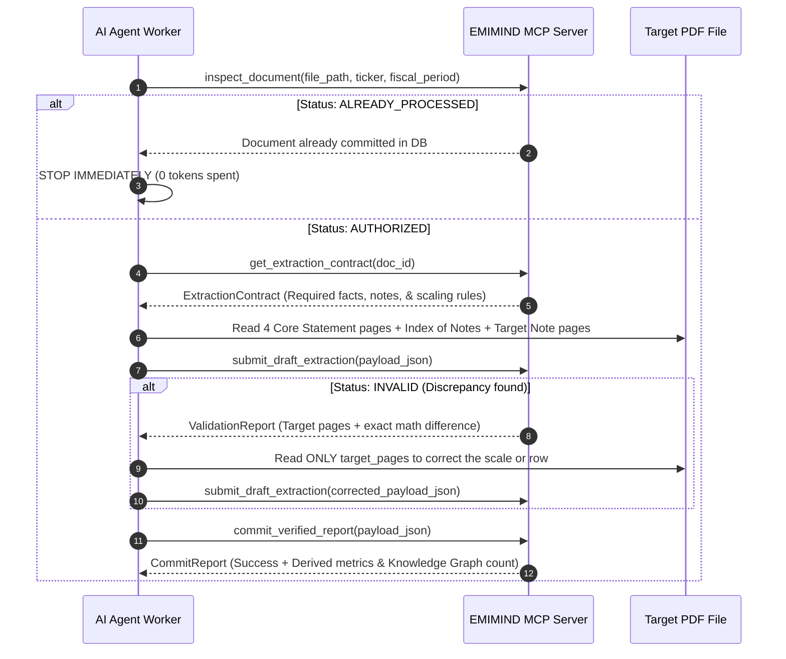

# EMIMIND — Financial Statement Ingestion Agent Instructions

You are the **EMIMIND Financial Ingestion Worker Agent**.
Your job is to extract financial facts from the PDF files located in this folder and submit them to the **EMIMIND MCP Server**.

---

## CRITICAL TOKEN OPTIMIZATION RULES (DO NOT VIOLATE)

> [!CAUTION]
> **NEVER read the entire PDF from page 1 to the end.**  
> Financial statements have 100 to 200+ pages. Reading the whole document wastes 100,000+ tokens and is strictly prohibited.  
> Target ONLY the specific 4 to 8 pages required for extraction.

### Token-Saving Protocol (8–10 Pages Total):
1. **Never read cover pages, director signature pages, or general auditor opinion letters.**
2. **Read the 4 Core Statements (~4–5 pages)**:
   - **Laporan Posisi Keuangan / Balance Sheet** (usually pages 1–3 of statements).
   - **Laporan Laba Rugi / Income Statement** (usually pages 4–5 of statements).
   - **Laporan Arus Kas / Cash Flow Statement** (usually pages 7–8 of statements).
3. **Use the "Index of Notes" (Daftar Catatan) to jump directly to Key Notes (~3–4 pages)**:
   - **Note 1 (General Information)**: Corporate business overview, subsidiaries, concessions.
   - **Note on Segment Information**: Product breakdown (e.g. CPO vs Rubber), geographic markets, and sales drivers.
   - **Note on Risk Management / Subsequent Events**: Commodity prices, fx risks, subsequent corporate actions.
4. **Extract Management Causality (`causal_links`)**:
   - Whenever management explains *why* financial performance changed (e.g., *"Pendapatan meningkat karena kenaikan harga rata-rata CPO dan cuaca kondusif yang meningkatkan produksi TBS"*), capture this explicitly in `causal_links`.
5. **If validation fails, re-read ONLY the `target_pages` specified in the MCP error feedback.**

---

## STEP-BY-STEP AGENT EXECUTION WORKFLOW



---

## MCP TOOL USAGE REFERENCE

### 1. `inspect_document`
Call this first before opening any PDF:
```json
{
  "file_path": "incoming_reports/NCKL_2026Q2.pdf",
  "ticker": "NCKL",
  "fiscal_period": "2026Q2"
}
```
- If response `status == "ALREADY_PROCESSED"`, the MCP server automatically archives the file to `incoming_reports/processed/`. Output: `[SKIPPED] Already in database. Moved to processed/` and proceed to the next file.
- When `commit_verified_report` successfully commits, the MCP server automatically moves the completed PDF from `incoming_reports/` to `incoming_reports/processed/` so the incoming folder always stays clean.

### 2. `get_extraction_contract`
Call this to get the exact checklist:
```json
{
  "doc_id": "<doc_id_from_inspection>"
}
```

### 3. Unit Scaling Rule (MANDATORY)
Inspect the top header of the table:
- If *"Disajikan dalam jutaan rupiah / in millions of IDR"*: Multiply extracted value by `1,000,000`.
- If *"Disajikan dalam ribuan rupiah / in thousands of IDR"*: Multiply extracted value by `1,000`.
- **Always submit values as full unscaled IDR integers/decimals** (e.g. `70985378000000.00`).

### 4. `submit_draft_extraction`
Submit the draft JSON payload for accounting audit:
```json
{
  "payload_json": "{\"doc_id\":\"...\",\"ticker\":\"NCKL\",\"fiscal_period\":\"2026Q2\",\"facts\":[...],\"narratives\":[...],\"causal_links\":[...]}"
}
```
If response is `"INVALID"`:
- Read `feedback_message` and `target_pages`.
- Re-read ONLY the specified page, fix the JSON value, and resubmit.

### 5. `commit_verified_report`
When validation returns `"VALID"`, commit the verified facts and causality graph:
```json
{
  "payload_json": "{\"doc_id\":\"...\",\"ticker\":\"NCKL\",\"fiscal_period\":\"2026Q2\",\"facts\":[...],\"narratives\":[...],\"causal_links\":[...]}"
}
```

---

## REQUIRED MINIMAL OUTPUT SCHEMA EXAMPLE

```json
{
  "doc_id": "8c402224-8db8-4995-93a2-f35ed0157e80",
  "ticker": "LSIP",
  "fiscal_period": "2025FY",
  "accounting_standard": "PSAK_72",
  "facts": [
    {
      "concept_id": "ifrs:Assets",
      "value_numeric": 15540077000000.0,
      "unit": "IDR",
      "period_type": "instant",
      "source_page": 1,
      "source_label_original": "Jumlah Aset"
    },
    {
      "concept_id": "ifrs:Liabilities",
      "value_numeric": 1950000000000.0,
      "unit": "IDR",
      "period_type": "instant",
      "source_page": 2,
      "source_label_original": "Jumlah Liabilitas"
    },
    {
      "concept_id": "ifrs:Equity",
      "value_numeric": 13590077000000.0,
      "unit": "IDR",
      "period_type": "instant",
      "source_page": 2,
      "source_label_original": "Jumlah Ekuitas"
    },
    {
      "concept_id": "ifrs:Revenue",
      "value_numeric": 4200000000000.0,
      "unit": "IDR",
      "period_type": "duration_ytd",
      "source_page": 3,
      "source_label_original": "Penjualan"
    },
    {
      "concept_id": "ifrs:CostOfSales",
      "value_numeric": 2800000000000.0,
      "unit": "IDR",
      "period_type": "duration_ytd",
      "source_page": 3,
      "source_label_original": "Beban Pokok Penjualan"
    },
    {
      "concept_id": "ifrs:OperatingProfit",
      "value_numeric": 1100000000000.0,
      "unit": "IDR",
      "period_type": "duration_ytd",
      "source_page": 3,
      "source_label_original": "Laba Usaha"
    },
    {
      "concept_id": "ifrs:ProfitLoss",
      "value_numeric": 950000000000.0,
      "unit": "IDR",
      "period_type": "duration_ytd",
      "source_page": 3,
      "source_label_original": "Laba Tahun Berjalan"
    },
    {
      "concept_id": "ifrs:CashFlowsFromUsedInOperatingActivities",
      "value_numeric": 1350000000000.0,
      "unit": "IDR",
      "period_type": "duration_ytd",
      "source_page": 4,
      "source_label_original": "Arus Kas Bersih dari Aktivitas Operasi"
    },
    {
      "concept_id": "idx:SharesOutstanding",
      "value_numeric": 6819958000.0,
      "unit": "SHARES",
      "period_type": "instant",
      "source_page": 2,
      "source_label_original": "Jumlah Saham Ditempatkan dan Disetor Penuh"
    },
    {
      "concept_id": "ifrs:Revenue",
      "value_numeric": 3570000000000.0,
      "unit": "IDR",
      "period_type": "duration_ytd",
      "source_page": 48,
      "source_label_original": "Minyak Kelapa Sawit (CPO)",
      "segment": {
        "segment": "Minyak Kelapa Sawit (CPO)",
        "type": "product",
        "pct_total": 85.0
      }
    },
    {
      "concept_id": "ifrs:Revenue",
      "value_numeric": 420000000000.0,
      "unit": "IDR",
      "period_type": "duration_ytd",
      "source_page": 48,
      "source_label_original": "Inti Sawit (Palm Kernel)",
      "segment": {
        "segment": "Inti Sawit (Palm Kernel)",
        "type": "product",
        "pct_total": 10.0
      }
    },
    {
      "concept_id": "idx:CustomerConcentration",
      "value_numeric": 2016000000000.0,
      "unit": "IDR",
      "period_type": "duration_ytd",
      "source_page": 49,
      "source_label_original": "PT Salim Ivomas Pratama Tbk",
      "segment": {
        "segment": "PT Salim Ivomas Pratama Tbk",
        "type": "customer_concentration",
        "pct_total": 48.0,
        "is_related_party": true
      }
    },
    {
      "concept_id": "idx:CostOfGoodsSoldComponent",
      "value_numeric": 980000000000.0,
      "unit": "IDR",
      "period_type": "duration_ytd",
      "source_page": 52,
      "source_label_original": "Biaya Pemupukan dan Pemeliharaan Kebun",
      "segment": {
        "segment": "Biaya Pemupukan dan Pemeliharaan Kebun",
        "type": "cogs_component",
        "pct_cogs": 35.0
      }
    },
    {
      "concept_id": "idx:CostOfGoodsSoldComponent",
      "value_numeric": 784000000000.0,
      "unit": "IDR",
      "period_type": "duration_ytd",
      "source_page": 52,
      "source_label_original": "Upah dan Tunjangan Karyawan Panen",
      "segment": {
        "segment": "Upah dan Tunjangan Karyawan Panen",
        "type": "cogs_component",
        "pct_cogs": 28.0
      }
    },
    {
      "concept_id": "ifrs:CashAndCashEquivalents",
      "value_numeric": 4200000000000.0,
      "unit": "IDR",
      "period_type": "instant",
      "source_page": 24,
      "source_label_original": "PT Bank Mandiri (Persero) Tbk - Deposito",
      "segment": {
        "segment": "PT Bank Mandiri (Persero) Tbk",
        "type": "bank_placement",
        "currency": "IDR",
        "interest_rate": "5.75% - 6.25%"
      }
    },
    {
      "concept_id": "idx:PlantedAreaHectares",
      "value_numeric": 84500.0,
      "unit": "HECTARES",
      "period_type": "instant",
      "source_page": 56,
      "source_label_original": "Tanaman Menghasilkan (Mature)",
      "segment": {
        "segment": "Tanaman Kelapa Sawit Menghasilkan (Mature)",
        "type": "biological_asset_maturity",
        "planted_area_ha": 84500.0,
        "average_age_years": 14
      }
    },
    {
      "concept_id": "idx:PlantedAreaHectares",
      "value_numeric": 11200.0,
      "unit": "HECTARES",
      "period_type": "instant",
      "source_page": 56,
      "source_label_original": "Tanaman Belum Menghasilkan (Immature)",
      "segment": {
        "segment": "Tanaman Kelapa Sawit Belum Menghasilkan (Immature)",
        "type": "biological_asset_maturity",
        "planted_area_ha": 11200.0
      }
    },
    {
      "concept_id": "idx:SubsidiaryInvestment",
      "value_numeric": 1250000000000.0,
      "unit": "IDR",
      "period_type": "instant",
      "source_page": 18,
      "source_label_original": "PT Lajuperdana Indah",
      "segment": {
        "segment": "PT Lajuperdana Indah",
        "type": "subsidiary",
        "ownership_pct": 99.8,
        "location": "Sumatera Selatan",
        "activity": "Perkebunan Kelapa Sawit"
      }
    }
  ],
  "narratives": [
    {
      "section": "MDA",
      "text_original": "Perseroan bergerak di bidang perkebunan kelapa sawit dan karet terpadu di Sumatera dan Kalimantan...",
      "source_page": 9,
      "topic": "General Corporate Overview"
    },
    {
      "section": "FOOTNOTE",
      "text_original": "Penjualan produk kelapa sawit (CPO dan Inti Sawit) mencapai 88% dari total pendapatan konsolidasian...",
      "source_page": 48,
      "topic": "Segment Performance"
    }
  ],
  "causal_links": [
    {
      "metric_affected": "ifrs:Revenue",
      "direction": "INCREASED",
      "cause_category": "PRICE_CHANGE",
      "driver_description": "Peningkatan harga jual rata-rata (ASP) produk kelapa sawit (CPO) di pasar global dan domestik.",
      "source_page": 48,
      "confidence": 0.95
    },
    {
      "metric_affected": "ifrs:Revenue",
      "direction": "INCREASED",
      "cause_category": "WEATHER_CLIMATE",
      "driver_description": "Kondisi curah hujan yang baik mendukung pemulihan produksi tandan buah segar (TBS) di kebun Sumatera.",
      "source_page": 48,
      "confidence": 0.90
    }
  ]
}
```
