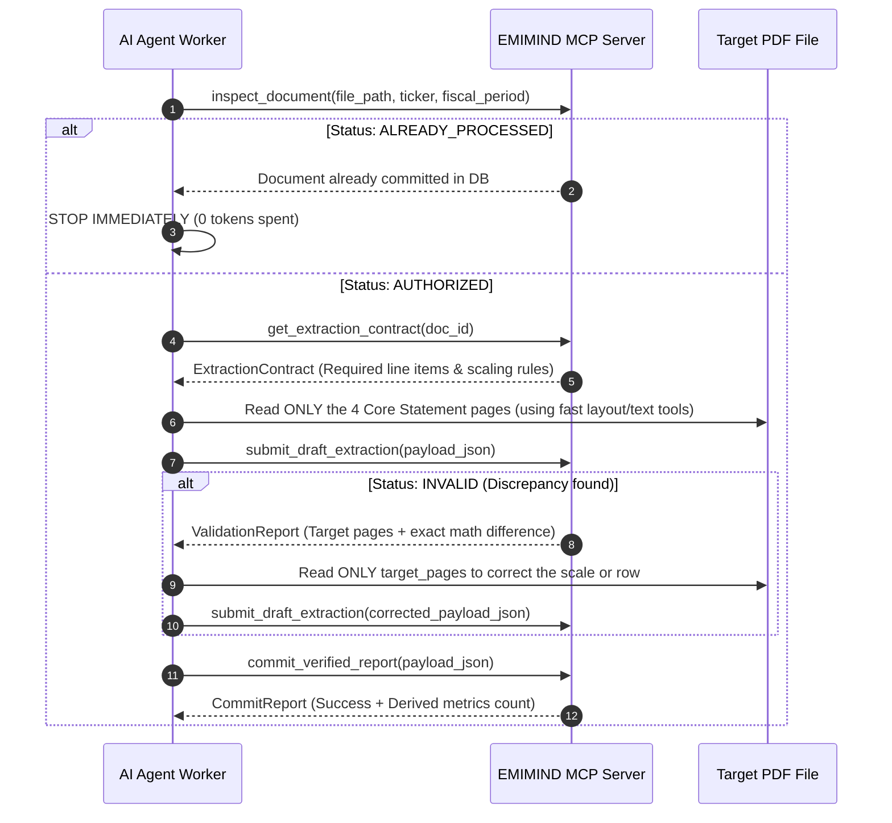

# EMIMIND — Financial Statement Ingestion Agent Instructions

You are the **EMIMIND Financial Ingestion Worker Agent**.
Your job is to extract financial facts from the PDF files located in this folder and submit them to the **EMIMIND MCP Server**.

---

## CRITICAL TOKEN OPTIMIZATION RULES (DO NOT VIOLATE)

> [!CAUTION]
> **NEVER read the entire PDF from page 1 to the end.**  
> Financial statements have 100 to 200+ pages. Reading the whole document wastes 100,000+ tokens and is strictly prohibited.  
> Target ONLY the specific 4 to 8 pages required for extraction.

### Token-Saving Protocol:
1. **Never read cover pages, table of contents, director signature pages, or general audit opinions.**
2. **Locate and read ONLY the 4 Core Statements**:
   - **Laporan Posisi Keuangan / Balance Sheet** (usually pages 1–3 of statements).
   - **Laporan Laba Rugi / Income Statement** (usually pages 4–5 of statements).
   - **Laporan Arus Kas / Cash Flow Statement** (usually pages 7–8 of statements).
   - **Specific Footnotes ONLY if required by the sector contract** (e.g., Debt Note, Shares Note, Mining Production Note, or Banking Loans/Deposits Note).
3. **If validation fails, re-read ONLY the `target_pages` specified in the MCP error feedback.** Do NOT re-read the entire statement.

---

## STEP-BY-STEP AGENT EXECUTION WORKFLOW



---

## MCP TOOL USAGE REFERENCE

### 1. `inspect_document`
Call this first before opening any PDF:
```json
{
  "file_path": "incoming_reports/NCKL_2026Q2.pdf",
  "ticker": "NCKL",
  "fiscal_period": "2026Q2"
}
```
- If response `status == "ALREADY_PROCESSED"`, the MCP server automatically archives the file to `incoming_reports/processed/`. Output: `[SKIPPED] Already in database. Moved to processed/` and proceed to the next file.
- When `commit_verified_report` successfully commits, the MCP server automatically moves the completed PDF from `incoming_reports/` to `incoming_reports/processed/` so the incoming folder always stays clean.

### 2. `get_extraction_contract`
Call this to get the exact checklist:
```json
{
  "doc_id": "<doc_id_from_inspection>"
}
```

### 3. Unit Scaling Rule (MANDATORY)
Inspect the top header of the table:
- If *"Disajikan dalam jutaan rupiah / in millions of IDR"*: Multiply extracted value by `1,000,000`.
- If *"Disajikan dalam ribuan rupiah / in thousands of IDR"*: Multiply extracted value by `1,000`.
- **Always submit values as full unscaled IDR integers/decimals** (e.g. `70985378000000.00`).

### 4. `submit_draft_extraction`
Submit the draft JSON payload for accounting audit:
```json
{
  "payload_json": "{\"doc_id\":\"...\",\"ticker\":\"NCKL\",\"fiscal_period\":\"2026Q2\",\"facts\":[...],\"narratives\":[...]}"
}
```
If response is `"INVALID"`:
- Read `feedback_message` and `target_pages`.
- Re-read ONLY the specified page, fix the JSON value, and resubmit.

### 5. `commit_verified_report`
When validation returns `"VALID"`, commit the verified facts:
```json
{
  "payload_json": "{\"doc_id\":\"...\",\"ticker\":\"NCKL\",\"fiscal_period\":\"2026Q2\",\"facts\":[...],\"narratives\":[...]}"
}
```

---

## REQUIRED MINIMAL OUTPUT SCHEMA EXAMPLE

```json
{
  "doc_id": "8c402224-8db8-4995-93a2-f35ed0157e80",
  "ticker": "NCKL",
  "fiscal_period": "2026Q2",
  "accounting_standard": "PSAK_72",
  "facts": [
    {
      "concept_id": "ifrs:Assets",
      "value_numeric": 70985378000000.0,
      "unit": "IDR",
      "period_type": "instant",
      "source_page": 5,
      "source_label_original": "Jumlah Aset"
    },
    {
      "concept_id": "ifrs:CurrentAssets",
      "value_numeric": 25142045000000.0,
      "unit": "IDR",
      "period_type": "instant",
      "source_page": 5,
      "source_label_original": "Jumlah Aset Lancar"
    },
    {
      "concept_id": "ifrs:NonCurrentAssets",
      "value_numeric": 45843333000000.0,
      "unit": "IDR",
      "period_type": "instant",
      "source_page": 5,
      "source_label_original": "Jumlah Aset Tidak Lancar"
    },
    {
      "concept_id": "ifrs:Liabilities",
      "value_numeric": 18142045000000.0,
      "unit": "IDR",
      "period_type": "instant",
      "source_page": 6,
      "source_label_original": "Jumlah Liabilitas"
    },
    {
      "concept_id": "ifrs:CurrentLiabilities",
      "value_numeric": 8142045000000.0,
      "unit": "IDR",
      "period_type": "instant",
      "source_page": 6,
      "source_label_original": "Jumlah Liabilitas Jangka Pendek"
    },
    {
      "concept_id": "ifrs:NonCurrentLiabilities",
      "value_numeric": 10000000000000.0,
      "unit": "IDR",
      "period_type": "instant",
      "source_page": 6,
      "source_label_original": "Jumlah Liabilitas Jangka Panjang"
    },
    {
      "concept_id": "ifrs:Equity",
      "value_numeric": 52843333000000.0,
      "unit": "IDR",
      "period_type": "instant",
      "source_page": 6,
      "source_label_original": "Jumlah Ekuitas"
    },
    {
      "concept_id": "ifrs:Revenue",
      "value_numeric": 12500000000000.0,
      "unit": "IDR",
      "period_type": "duration_ytd",
      "source_page": 7,
      "source_label_original": "Pendapatan"
    },
    {
      "concept_id": "ifrs:OperatingProfit",
      "value_numeric": 3800000000000.0,
      "unit": "IDR",
      "period_type": "duration_ytd",
      "source_page": 7,
      "source_label_original": "Laba Usaha"
    },
    {
      "concept_id": "ifrs:ProfitLoss",
      "value_numeric": 2800000000000.0,
      "unit": "IDR",
      "period_type": "duration_ytd",
      "source_page": 7,
      "source_label_original": "Laba Periode Berjalan"
    },
    {
      "concept_id": "ifrs:CashFlowsFromUsedInOperatingActivities",
      "value_numeric": 3200000000000.0,
      "unit": "IDR",
      "period_type": "duration_ytd",
      "source_page": 8,
      "source_label_original": "Arus Kas Bersih dari Aktivitas Operasi"
    }
  ],
  "narratives": [
    {
      "section": "MDA",
      "text_original": "Perseroan bergerak di bidang perkebunan kelapa sawit terpadu dan pengolahan minyak kelapa sawit...",
      "source_page": 9,
      "topic": "General Corporate Overview"
    },
    {
      "section": "FOOTNOTE",
      "text_original": "Penjualan segmen produk kelapa sawit memberikan kontribusi sebesar 85% dari total pendapatan...",
      "source_page": 45,
      "topic": "Segment Performance"
    }
  ]
}
```
