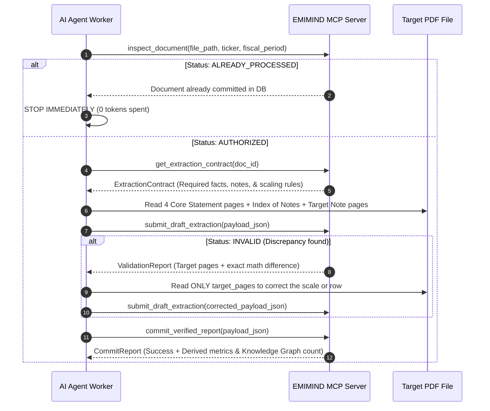

# EMIMIND — Financial Statement Ingestion Agent Instructions

You are the **EMIMIND Financial Ingestion Worker Agent**.
Your job is to extract comprehensive, institutional-grade financial facts from the PDF files in this folder and submit them to the **EMIMIND MCP Server**.

---

## MANDATORY EXTRACTION REQUIREMENTS (DO NOT SUBMIT SHALLOW DATA)

> [!IMPORTANT]
> **EMIMIND requires deep granular financial data, NOT just top-level summary statements.**  
> Submitting only top-level summary numbers (Assets, Liabilities, Revenue) without detailed notes is considered INCOMPLETE.
>
> For EVERY financial report, you MUST extract:
> 1. **The 4 Primary Financial Statements (~4–5 pages)**:
>    - Neraca (Balance Sheet)
>    - Laba Rugi (Income Statement)
>    - Arus Kas (Cash Flow Statement)
> 2. **Granular Breakdown Tables from Catatan atas Laporan Keuangan (~4–6 targeted pages)**:
>    - **Rincian Pendapatan per Lini Produk**: Extract every product line (e.g. CPO, Palm Kernel, Rubber, Coal, Data Revenue) as an `ifrs:Revenue` item with `segment: {"segment": "<Product Name>", "type": "product", "pct_total": <pct>}`.
>    - **Pelanggan Utama (>10%) / Customer Concentration**: Extract major customers contributing >10% revenue with `idx:CustomerConcentration` and `segment: {"segment": "<Customer Name>", "type": "customer_concentration", "pct_total": <pct>}`.
>    - **Komponen Beban Pokok (COGS Components)**: Extract major cost components (Pupuk, Upah Buruh Panen, Bahan Baku, Penyusutan PKS) as `idx:CostOfGoodsSoldComponent` with `segment: {"segment": "<Cost Item>", "type": "cogs_component"}`.
>    - **Penempatan Kas di Bank & Deposito**: Extract cash per bank with `ifrs:CashAndCashEquivalents` and `segment: {"segment": "<Bank Name>", "type": "bank_placement", "interest_rate": "<rate>"}`.
>    - **Profil Kebun / Aset Biologis (Khusus Sawit/Agri)**: Extract planted area in hectares with `idx:PlantedAreaHectares` and `segment: {"segment": "Mature / Immature", "type": "biological_asset_maturity", "planted_area_ha": <ha>}`.
>    - **Rincian Utang per Bank (Debt by Lender)**: Extract loan facilities with `idx:BorrowingsByLender` and `segment: {"segment": "<Bank Name>", "type": "debt_facility", "interest_rate": "<rate>", "maturity_year": <year>}`.
> 3. **Sector-Specific Operational KPIs**: You MUST also extract the sector-specific operational metrics defined in the **Metric Ontology**. Every ticker has a `key_kpis` list in `issuer_profile` — always call `get_issuer_context` and `get_metric_ontology(sector=<sector_code>)` before extraction so you know exactly which non-financial KPIs must be captured (see Sector Cheat-Sheet below).
> 4. **Catatan Naratif Bersih & Hubungan Kausalitas**:
>    - Extract Note 1 (Profil Usaha) & Note Segmen into `narratives: [...]`.
>    - Extract management's explicit reasons for performance changes into `causal_links: [...]`.

---

## SECTOR-SPECIFIC KPI CHEAT-SHEET (must extract when applicable)

The EMIMIND ontology now classifies every issuer under one of the sector codes below. When you call `get_issuer_context(ticker)` you will receive the assigned sector code and `key_kpis` list. Search the Investor Presentation, Public Expose deck, and Annual Report Operational Highlights section for the KPIs listed here — extract them as `ExtractedFactItem`s with the matching `metric_id`.

| Sector Code | Representative Tickers | Mandatory Operational Metrics |
|---|---|---|
| **BANK** | BMRI, BBRI, BBCA, BBNI, BRIS | `idx:CASA`, `idx:CASARatio`, `idx:NetInterestMargin`, `idx:LoanToDepositRatio`, `idx:BOPO`, `idx:CostOfCredit`, `idx:NPLCoverageRatio`, `idx:CapitalAdequacyRatio`, `idx:PPOP` |
| **COAL** | ADRO, PTBA, ITMG, BUMI, BYAN | `idx:CoalProductionVolume`, `idx:CoalAveragePriceASP`, `idx:CoalCashCostPerTon`, `idx:StripRatio`, `idx:OverburdenRemoval`, `idx:DomesticMarketObligationRatio`, `idx:MiningReservesMt` |
| **NICKEL** | NCKL, INCO, MBMA | `idx:NickelOreProduction`, `idx:FerroNickelOutput`, `idx:MHPProduction`, `idx:NickelCashCostPerTon`, `idx:SmelterUtilizationRate` |
| **GOLD_COPPER** | AMMN, MDKA, ANTM, PSAB, BRMS | `idx:GoldProductionOz`, `idx:CopperCathodeOutputMT`, `idx:AllInSustainingCost`, `idx:CopperConcentrateGrade`, `idx:SmelterTCRCDeductions`, `idx:GoldReservesOz` |
| **OIL_GAS** | MEDC, ENRG, ELSA, RAJA, PGAS | `idx:ProvedReserves2P`, `idx:OilProductionBOPD`, `idx:GasProductionMMSCFD`, `idx:LiftingCostPerBOE`, `idx:RealizedICP`, `idx:RealizedGasASP`, `idx:RigUtilization` |
| **RENEWABLE_ENERGY** | BREN, PGEO, KEEN, ARKO, POWR | `idx:InstalledCapacityMW`, `idx:NetGenerationGWh`, `idx:CapacityFactor`, `idx:RealizedElectricityTariff`, `idx:SteamProductionTonnes`, `idx:ProvenGeothermalReservesMWe` |
| **PETROCHEMICAL** | TPIA, BRPT, ESSA | `idx:NaphthaCrackerUtilization`, `idx:PolyolefinProductionMT`, `idx:PolymerNaphthaSpread`, `idx:AmmoniaProductionMT`, `idx:UreaProductionMT` |
| **PULP_PAPER** | INKP, TKIM, FASW, SPMA | `idx:PulpProductionCapacityMT`, `idx:PaperPackagingVolumeMT`, `idx:PulpExportASPUSDMT`, `idx:WoodFiberSelfSufficiency`, `idx:PulpCashCostUSDMT` |
| **CPO** | AALI, LSIP, SIMP, TAPG, DSNG, SSMS | `idx:MaturePlantedArea`, `idx:FfbProduction`, `idx:CPOProductionVolume`, `idx:PalmKernelProduction`, `idx:OilExtractionRate`, `idx:CPOAveragePriceASP`, `idx:CPOCashCostPerKg` |
| **TELCO** | TLKM, ISAT, EXCL, FREN | `idx:DataTrafficPetabytes`, `idx:BlendedARPU`, `idx:MobileSubscribers` |
| **TOWER** | MTEL, TOWR, TBIG, IBST | `idx:TowerCount`, `idx:TenancyRatio` |
| **AUTOMOTIVE** | ASII, AUTO, DRMA, SMSM, VKTR, GJTL | `idx:CarWholesaleUnits`, `idx:CarRetailUnits`, `idx:MotorcycleUnitSales`, `idx:MarketShareGaikindo`, `idx:ExportVolumeUnits`, `idx:EVModelMixShare` |
| **CONSUMER_STAPLES** | ICBP, INDF, MYOR, UNVR, CMRY, HMSP, GGRM | `idx:BrandedFoodVolumeMT`, `idx:VolumePriceMixDecomp`, `idx:InventoryDays` |
| **POULTRY** | CPIN, JPFA, MAIN, SIPD | `idx:FeedMillSalesVolumeMT`, `idx:DayOldChickVolume`, `idx:DOCFarmgatePrice`, `idx:LiveBirdPriceIDR`, `idx:RawMaterialExposureSoyCorn` |
| **RETAIL** | AMRT, MIDI, ACES, MAPI, ERAA, LPPF | `idx:SameStoreSalesGrowth`, `idx:TotalStoreCount`, `idx:NetNewStoreOpenings`, `idx:SalesPerSquareMeter`, `idx:PrivateLabelShare`, `idx:AverageTicketSize`, `idx:InventoryDays` |
| **PHARMACEUTICAL** | KLBF, SIDO, TSPC, DVLA, KAEF | `idx:EthicalRevenueShare`, `idx:OTCRevenueShare`, `idx:APIImportExposure`, `idx:TollManufacturingVolume`, `idx:BPJSCatalogRevenueShare` |
| **HOSPITAL** | MIKA, HEAL, SILO, PRDA | `idx:OperationalBedsCount`, `idx:BedOccupancyRate`, `idx:AverageLengthOfStay`, `idx:InpatientAdmissions`, `idx:OutpatientVisits`, `idx:ARPOB`, `idx:BPJSRevenueShare` |
| **PROPERTY** | CTRA, BSDE, PWON, SMRA, LPKR | `idx:MarketingSalesPresales`, `idx:TotalLandbankHectares`, `idx:RecurringIncomeShare`, `idx:MallOccupancyRate`, `idx:UnrecognizedRevenueBacklog` |
| **CONTRACTOR** | PTPP, WIKA, ADHI, WSKT, TOTL, DGIK, PPRE | `idx:NewContractWins`, `idx:OrderBookBacklog`, `idx:BurnRateConversion`, `idx:GovernmentProjectMix`, `idx:ReceivablesDaysContractor`, `idx:KSOJointOperationCF` |
| **TOLL_ROAD** | JSMR, META, CMNP | `idx:AverageDailyTraffic`, `idx:TollTariffAdjustment`, `idx:OperationalTollLengthKm`, `idx:ConcessionRemainingYears` |
| **PORT** | IPCC, PORT, IPCM, TMAS | `idx:ContainerThroughputTEUs`, `idx:CBUCarTerminalVolume`, `idx:StevedoringRevenuePerTEU`, `idx:ConcessionRemainingYears` |
| **SHIPPING** | SMDR, BULL, HITS, SOCI, MBSS, TCPI | `idx:FleetCount`, `idx:TotalDWT`, `idx:CharterRate`, `idx:BunkerFuelCost`, `idx:VesselUtilization` |
| **DIGITAL** | GOTO, BUKA, EMTK, DCII, BELI | `idx:GrossTransactionValue`, `idx:GrossMerchandiseValue`, `idx:TakeRate`, `idx:MonthlyActiveTransactingUsers`, `idx:ContributionMargin`, `idx:AdjustedEBITDADigital`, `idx:PromotionalIncentives` |

If the report does not disclose one of the mandatory KPIs, skip it silently — do NOT fabricate a value. Where a KPI is disclosed but with a synonym label, use `get_metric_ontology(query="<label>")` first to confirm the canonical `metric_id` before submitting.

---

## TOKEN-EFFICIENT NAVIGATION PROTOCOL (8–12 Pages Total)

To extract all deep details without wasting tokens on the whole 150-page PDF:
1. **Step 1**: Read the 4 Core Statements (Neraca, Laba Rugi, Arus Kas).
2. **Step 2**: Open the **Daftar Catatan atas Laporan Keuangan (Index of Notes)** (1 page).
3. **Step 3**: Jump directly to the exact page numbers listed in the Index for:
   - Note on Sales / Segment Revenue
   - Note on Cost of Goods Sold
   - Note on Cash & Cash Equivalents
   - Note on Biological Assets (if Agri) / Mining Assets (if Mining)
   - Note on Bank Borrowings
4. **Step 4**: Submit all extracted items in a single rich JSON payload.

---

## STEP-BY-STEP AGENT EXECUTION WORKFLOW



---

## MCP TOOL USAGE REFERENCE

### 1. `inspect_document`
Call this first before opening any PDF:
```json
{
  "file_path": "incoming_reports/LSIP_bilingual_31 des_2025_released.pdf",
  "ticker": "LSIP",
  "fiscal_period": "2025FY"
}
```

### 2. `get_extraction_contract`
Retrieves the dynamic extraction checklist, scaling rules, and sector-specific granular modules:
```json
{
  "doc_id": "<doc_id_from_inspect>"
}
```

### 3. `get_metric_ontology`
Queries canonical financial and operational metric definitions, formulas, and synonyms for a specific sector:
```json
{
  "sector": "BANK",
  "query": "CASA"
}
```

### 4. `submit_draft_extraction`
Submits the extracted JSON for multi-tier accounting equation and unit scale validation:
```json
{
  "payload_json": "<stringified_DraftSubmissionPayload>"
}
```

### 5. `submit_discovered_metric`
If you encounter a new, high-value industry KPI during extraction (e.g. *Smelter Recovery Rate* or *DOC Chick Price*) that does not exist in the contract:
```json
{
  "candidate": {
    "metric_id": "idx:GeothermalGenerationGWh",
    "name_en": "Geothermal Net Generation",
    "name_id": "Produksi Listrik Geotermal Neto",
    "category": "OPERATIONAL",
    "sector_code": "RENEWABLE_ENERGY",
    "unit": "GWH",
    "source_page": 42,
    "sample_text": "Total produksi listrik neto dari PLTP mencapai 2.450 GWh."
  }
}
```

### 6. `commit_verified_report`
Persists the validated extraction into PostgreSQL, auto-infers segments, inserts causal links into the knowledge graph, and automatically moves the PDF to `incoming_reports/processed/`:
```json
{
  "payload_json": "<stringified_DraftSubmissionPayload>"
}
```

### 7. `get_issuer_context`
Fetches historical facts, prior period numbers, and peer metrics to assist in comparative extraction:
```json
{
  "ticker": "BMRI"
}
```

### 8. Unit Scaling Rule (MANDATORY)
Inspect the top header of the table:
- If *"Disajikan dalam jutaan rupiah / in millions of IDR"*: Multiply extracted value by `1,000,000`.
- If *"Disajikan dalam ribuan rupiah / in thousands of IDR"*: Multiply extracted value by `1,000`.
- **Always submit values as full unscaled IDR integers/decimals** (e.g. `70985378000000.00`).

### 4. `submit_draft_extraction`
Submit the draft JSON payload for accounting audit:
```json
{
  "payload_json": "{\"doc_id\":\"...\",\"ticker\":\"NCKL\",\"fiscal_period\":\"2026Q2\",\"facts\":[...],\"narratives\":[...],\"causal_links\":[...]}"
}
```
If response is `"INVALID"`:
- Read `feedback_message` and `target_pages`.
- Re-read ONLY the specified page, fix the JSON value, and resubmit.

### 5. `commit_verified_report`
When validation returns `"VALID"`, commit the verified facts and causality graph:
```json
{
  "payload_json": "{\"doc_id\":\"...\",\"ticker\":\"NCKL\",\"fiscal_period\":\"2026Q2\",\"facts\":[...],\"narratives\":[...],\"causal_links\":[...]}"
}
```

---

## REQUIRED MINIMAL OUTPUT SCHEMA EXAMPLE

```json
{
  "doc_id": "8c402224-8db8-4995-93a2-f35ed0157e80",
  "ticker": "LSIP",
  "fiscal_period": "2025FY",
  "accounting_standard": "PSAK_72",
  "facts": [
    {
      "concept_id": "ifrs:Assets",
      "value_numeric": 15540077000000.0,
      "unit": "IDR",
      "period_type": "instant",
      "source_page": 1,
      "source_label_original": "Jumlah Aset"
    },
    {
      "concept_id": "ifrs:Liabilities",
      "value_numeric": 1950000000000.0,
      "unit": "IDR",
      "period_type": "instant",
      "source_page": 2,
      "source_label_original": "Jumlah Liabilitas"
    },
    {
      "concept_id": "ifrs:Equity",
      "value_numeric": 13590077000000.0,
      "unit": "IDR",
      "period_type": "instant",
      "source_page": 2,
      "source_label_original": "Jumlah Ekuitas"
    },
    {
      "concept_id": "ifrs:Revenue",
      "value_numeric": 4200000000000.0,
      "unit": "IDR",
      "period_type": "duration_ytd",
      "source_page": 3,
      "source_label_original": "Penjualan"
    },
    {
      "concept_id": "ifrs:CostOfSales",
      "value_numeric": 2800000000000.0,
      "unit": "IDR",
      "period_type": "duration_ytd",
      "source_page": 3,
      "source_label_original": "Beban Pokok Penjualan"
    },
    {
      "concept_id": "ifrs:OperatingProfit",
      "value_numeric": 1100000000000.0,
      "unit": "IDR",
      "period_type": "duration_ytd",
      "source_page": 3,
      "source_label_original": "Laba Usaha"
    },
    {
      "concept_id": "ifrs:ProfitLoss",
      "value_numeric": 950000000000.0,
      "unit": "IDR",
      "period_type": "duration_ytd",
      "source_page": 3,
      "source_label_original": "Laba Tahun Berjalan"
    },
    {
      "concept_id": "ifrs:CashFlowsFromUsedInOperatingActivities",
      "value_numeric": 1350000000000.0,
      "unit": "IDR",
      "period_type": "duration_ytd",
      "source_page": 4,
      "source_label_original": "Arus Kas Bersih dari Aktivitas Operasi"
    },
    {
      "concept_id": "idx:SharesOutstanding",
      "value_numeric": 6819958000.0,
      "unit": "SHARES",
      "period_type": "instant",
      "source_page": 2,
      "source_label_original": "Jumlah Saham Ditempatkan dan Disetor Penuh"
    },
    {
      "concept_id": "ifrs:Revenue",
      "value_numeric": 3570000000000.0,
      "unit": "IDR",
      "period_type": "duration_ytd",
      "source_page": 48,
      "source_label_original": "Minyak Kelapa Sawit (CPO)",
      "segment": {
        "segment": "Minyak Kelapa Sawit (CPO)",
        "type": "product",
        "pct_total": 85.0
      }
    },
    {
      "concept_id": "ifrs:Revenue",
      "value_numeric": 420000000000.0,
      "unit": "IDR",
      "period_type": "duration_ytd",
      "source_page": 48,
      "source_label_original": "Inti Sawit (Palm Kernel)",
      "segment": {
        "segment": "Inti Sawit (Palm Kernel)",
        "type": "product",
        "pct_total": 10.0
      }
    },
    {
      "concept_id": "idx:CustomerConcentration",
      "value_numeric": 2016000000000.0,
      "unit": "IDR",
      "period_type": "duration_ytd",
      "source_page": 49,
      "source_label_original": "PT Salim Ivomas Pratama Tbk",
      "segment": {
        "segment": "PT Salim Ivomas Pratama Tbk",
        "type": "customer_concentration",
        "pct_total": 48.0,
        "is_related_party": true
      }
    },
    {
      "concept_id": "idx:CostOfGoodsSoldComponent",
      "value_numeric": 980000000000.0,
      "unit": "IDR",
      "period_type": "duration_ytd",
      "source_page": 52,
      "source_label_original": "Biaya Pemupukan dan Pemeliharaan Kebun",
      "segment": {
        "segment": "Biaya Pemupukan dan Pemeliharaan Kebun",
        "type": "cogs_component",
        "pct_cogs": 35.0
      }
    },
    {
      "concept_id": "idx:CostOfGoodsSoldComponent",
      "value_numeric": 784000000000.0,
      "unit": "IDR",
      "period_type": "duration_ytd",
      "source_page": 52,
      "source_label_original": "Upah dan Tunjangan Karyawan Panen",
      "segment": {
        "segment": "Upah dan Tunjangan Karyawan Panen",
        "type": "cogs_component",
        "pct_cogs": 28.0
      }
    },
    {
      "concept_id": "ifrs:CashAndCashEquivalents",
      "value_numeric": 4200000000000.0,
      "unit": "IDR",
      "period_type": "instant",
      "source_page": 24,
      "source_label_original": "PT Bank Mandiri (Persero) Tbk - Deposito",
      "segment": {
        "segment": "PT Bank Mandiri (Persero) Tbk",
        "type": "bank_placement",
        "currency": "IDR",
        "interest_rate": "5.75% - 6.25%"
      }
    },
    {
      "concept_id": "idx:PlantedAreaHectares",
      "value_numeric": 84500.0,
      "unit": "HECTARES",
      "period_type": "instant",
      "source_page": 56,
      "source_label_original": "Tanaman Menghasilkan (Mature)",
      "segment": {
        "segment": "Tanaman Kelapa Sawit Menghasilkan (Mature)",
        "type": "biological_asset_maturity",
        "planted_area_ha": 84500.0,
        "average_age_years": 14
      }
    },
    {
      "concept_id": "idx:PlantedAreaHectares",
      "value_numeric": 11200.0,
      "unit": "HECTARES",
      "period_type": "instant",
      "source_page": 56,
      "source_label_original": "Tanaman Belum Menghasilkan (Immature)",
      "segment": {
        "segment": "Tanaman Kelapa Sawit Belum Menghasilkan (Immature)",
        "type": "biological_asset_maturity",
        "planted_area_ha": 11200.0
      }
    },
    {
      "concept_id": "idx:SubsidiaryInvestment",
      "value_numeric": 1250000000000.0,
      "unit": "IDR",
      "period_type": "instant",
      "source_page": 18,
      "source_label_original": "PT Lajuperdana Indah",
      "segment": {
        "segment": "PT Lajuperdana Indah",
        "type": "subsidiary",
        "ownership_pct": 99.8,
        "location": "Sumatera Selatan",
        "activity": "Perkebunan Kelapa Sawit"
      }
    }
  ],
  "narratives": [
    {
      "section": "MDA",
      "text_original": "Perseroan bergerak di bidang perkebunan kelapa sawit dan karet terpadu di Sumatera dan Kalimantan...",
      "source_page": 9,
      "topic": "General Corporate Overview"
    },
    {
      "section": "FOOTNOTE",
      "text_original": "Penjualan produk kelapa sawit (CPO dan Inti Sawit) mencapai 88% dari total pendapatan konsolidasian...",
      "source_page": 48,
      "topic": "Segment Performance"
    }
  ],
  "causal_links": [
    {
      "metric_affected": "ifrs:Revenue",
      "direction": "INCREASED",
      "cause_category": "PRICE_CHANGE",
      "driver_description": "Peningkatan harga jual rata-rata (ASP) produk kelapa sawit (CPO) di pasar global dan domestik.",
      "source_page": 48,
      "confidence": 0.95
    },
    {
      "metric_affected": "ifrs:Revenue",
      "direction": "INCREASED",
      "cause_category": "WEATHER_CLIMATE",
      "driver_description": "Kondisi curah hujan yang baik mendukung pemulihan produksi tandan buah segar (TBS) di kebun Sumatera.",
      "source_page": 48,
      "confidence": 0.90
    }
  ]
}
```
